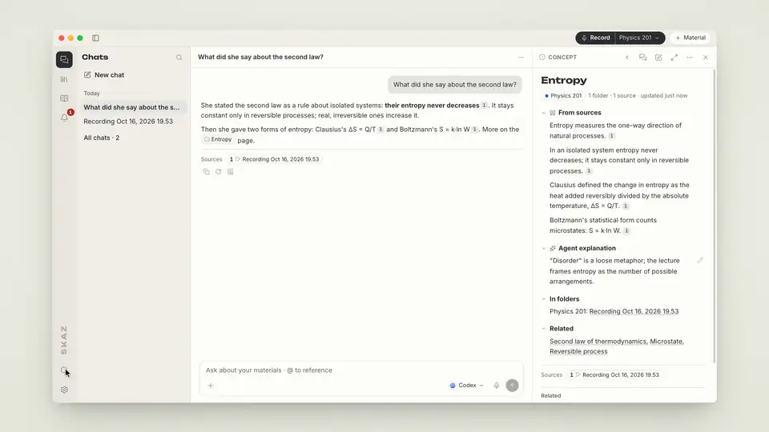

<div align="center">


# SKAZ

### Lectures, meetings and documents, turned into a wiki you can ask

Record or add a source · ask with exact citations · a wiki that keeps itself up to date

[](https://github.com/all0b0y/SKAZ/releases/latest)


[](LICENSE)

**English** · [Русский](docs/i18n/README.ru.md) · [Español](docs/i18n/README.es.md) · [Deutsch](docs/i18n/README.de.md) · [简体中文](docs/i18n/README.zh-CN.md)

<br>


<sub>Product tour · demo profile with authored data · <a href="docs/images/skaz-tour.mp4">Full HD video (MP4, 23 s)</a></sub>

<br><br>

[**Install**](#-install) · [**Features**](#-features) · [**Privacy**](#-privacy-and-data) · [**How it works**](#-how-it-works) · [**Contributing**](CONTRIBUTING.md)

</div>

---

SKAZ is a macOS app for what you listen to and read. Record a lecture or a meeting, or add a PDF,
an article, a video link or a file. SKAZ keeps every source in your own folder of Markdown files,
builds a wiki from it, and answers questions with links to the exact moment or page.

> [!WARNING]
> **Alpha / early access.** Expect bugs and breaking changes, including changes to stored
> data. Back up important exports. SKAZ targets macOS on Apple Silicon; Windows, Linux and
> Intel Macs are not verified. The interface is English-only for now.

## 💡 Why SKAZ

A lecture, last week's meeting, a chapter you read: they end up in different places, and nothing
connects them. SKAZ keeps them together. Every source gets notes and concept pages in one wiki,
so the same idea from a lecture and a textbook lands on one page. Ask *"what did she say about the
second law?"* and follow the footnote back to the second it was said.

AI can be wrong. Citations help you check an answer; they don't guarantee it is correct.

## 👀 See it in action

<table>
<tr>
<td width="50%"><br><b>Record into a folder</b><br>Pick the folder, press Record, and the transcript appears as people speak, by speaker and time.</td>
<td width="50%"><br><b>Ask with citations</b><br>Every claim has a footnote. Open it and SKAZ jumps to the quote in the source.</td>
</tr>
<tr>
<td width="50%"><br><b>A wiki that writes itself</b><br>Concept pages and notes built from your sources, marked with what is quoted and what the agent inferred.</td>
<td width="50%"><br><b>Search everything</b><br>⌘K finds wiki pages, materials and chats, or hands the question to the agent.</td>
</tr>
<tr>
<td colspan="2" align="center"><br><b>Light and dark</b><br>Follows your Mac, or pick a theme in <b>Settings → Appearance</b>.</td>
</tr>
</table>

<sub>Built from SKAZ 0.3.0's own interface (its HTML and CSS) with <a href="https://github.com/heygen-com/hyperframes">HyperFrames</a>.
The lecture, the answer and the wiki pages are authored demonstration data, not real speech
recognition or AI output.</sub>

## ✨ Features

| | |
|---|---|
| 🎙️ **Live recording** | Microphone, optionally with your Mac's sound (Zoom, videos; macOS 14.2+ and OS permission). Recognition with **Soniox** (cloud streaming, speaker separation, translation) or **Whisper on this computer** (works offline). SKAZ never silently switches services. |
| 📚 **Any source** | PDF, documents, text and Markdown files, audio and video files, web articles (cleaned up), pasted text of any length, and video links from YouTube, VK Video, RuTube and Vimeo. Use only material you are allowed to process. |
| 🧠 **A living wiki** | Notes for every source, one page per concept across all folders, and saved analyses. Each statement is marked: quoted from a source, a connection the agent inferred, or an agent's explanation. When sources disagree, both versions are shown and you decide. |
| 💬 **Chats with footnotes** | Ask about the whole library; the agent knows what is open and whether a recording is running. Footnotes open the exact moment of a recording or the page of a document. Point at a page, a material or a chat with **@**. |
| 🤖 **Your agent** | **Codex**, **Claude Code** or **Hermes Agent**, with your own subscription or key; SKAZ can install them for you. Agents read the library through read-only SKAZ tools. Small filing decisions can run on a local model or through OpenRouter. |
| ✍️ **Recognition fixes** | An optional check finds likely recognition errors, fixes the confident ones and only highlights the doubtful ones. Every fix can be undone. |
| 🗂️ **Plain files** | The library is a folder of `.md` files. Open it in **Obsidian**, or export everything as plain Markdown with sources as footnotes. Your own edits to wiki pages are protected from the agent. |
| 🔄 **Updates** | SKAZ checks GitHub releases at start and once a day and installs a verified update from **Settings → About**. |

## 📦 Install

Paste this into Terminal (Apple Silicon, macOS 13 or later):

```bash
curl -fsSL https://raw.githubusercontent.com/all0b0y/SKAZ/main/install.sh | bash
```

The [script](install.sh) downloads the latest release, checks its SHA-256 checksum and SKAZ's
signature, installs SKAZ into Applications and opens it. Run the same command to update — your
library and settings stay where they are. SKAZ is not notarized by Apple yet; an app installed
this way opens without the "Apple could not verify…" warning.

<details>
<summary><b>Install from the DMG or PKG instead</b></summary>
<br>

Download `SKAZ-<version>-arm64.dmg` (or the `.pkg` installer) from
[GitHub Releases](https://github.com/all0b0y/SKAZ/releases/latest), open it and drag SKAZ to
Applications. On the first launch macOS says it could not verify SKAZ: click **Done**, not
Move to Trash. Then open **System Settings → Privacy & Security** and click **Open Anyway**
next to the message about SKAZ. This is needed once per downloaded build. Do not disable macOS
security protections globally.

</details>

Want to run the current code instead? See the [development setup](CONTRIBUTING.md).

### 🚀 First launch

1. **Agent.** Choose Codex, Claude Code or Hermes Agent and sign in with your own account.
   SKAZ can install the agent for you. Provider eligibility, limits and charges apply.
2. **Speech.** Add a Soniox key and allow sending audio to Soniox — or pick **Whisper on this
   computer** and download a speech model (its size is shown first; no key needed).
3. **Library.** Choose where the library lives; SKAZ suggests a folder in Documents.
4. **Use it.** Press **Record** (the folder is picked next to it) or **+ Material** to add a
   file, a link or text. Ask in the chat; open **Wiki** to read what SKAZ built.

Every choice can be changed later in **Settings**.

> [!IMPORTANT]
> Get consent before recording other people. Soniox, the agents and OpenRouter have their own
> pricing and policies; the MIT license does not cover their usage.

## 🔒 Privacy and data

| What | Where it lives / goes |
|---|---|
| Materials and wiki | Plain `.md` files in the library folder you chose. |
| Index, chats, settings | Local files in SKAZ's own app folder. |
| Live audio | Not kept as an archive for playback. Temporary audio may be used for processing or recovery. |
| Speech recognition | **Soniox:** audio is sent after your consent, which you can take back at any time. **Whisper on this computer:** audio never leaves your Mac. |
| Agent | Your question and the parts of the library it reads go to the agent you chose; its retention and training policies apply. |
| Keys | An encrypted local file in SKAZ's app folder, with its encryption key beside it. File permissions are the main boundary — not protection from processes running as your user. |
| Activity log | Kept without conversation text or keys. |
| Backend | Python, loopback-only, with a fresh token on every launch. |

Text from your sources is data, never instructions: a passage that addresses an AI is left out of
the wiki, and SKAZ tells you, with a way to bring it back.
**Local storage does not mean offline processing.** Protect exports and backups too.
See the [security policy](SECURITY.md) for limitations and the reporting channel.

## 🧩 How it works

```text
Microphone / system audio / files / links → Electron → Python ── Soniox | Whisper on this Mac
                                              ↓          ↓
                                          React UI   Library: Materials/*.md, Wiki/*.md
                                                         ↕  read-only SKAZ tools
                                              Codex | Claude Code | Hermes Agent
```

| Layer | Stack |
|---|---|
| Desktop | Electron |
| Interface | React, TypeScript, CodeMirror |
| Local backend | Python, FastAPI, an SQLite index over the Markdown files |

## 🗺️ What's next

- [ ] Apple notarization for releases
- [ ] Illustrated answers and notes from PDF presentations
- [ ] Broader real-world validation

## 🤝 Contributing

[Contributing](CONTRIBUTING.md) covers setup, tests and pull requests; [Packaging](docs/PACKAGING.md)
covers building installers. Small fixes can go straight to a PR — please discuss larger changes in
an issue first. Release notes live in [GitHub Releases](https://github.com/all0b0y/SKAZ/releases).

[Community rules](CODE_OF_CONDUCT.md) · [Security policy](SECURITY.md) · [MIT license](LICENSE)

---

<div align="center">
<sub><i>Skaz</i> (сказ) is a Russian word for a spoken narrative. Formerly AudioHelper.<br>
Copyright © 2026 all0b0y.</sub>
</div>
