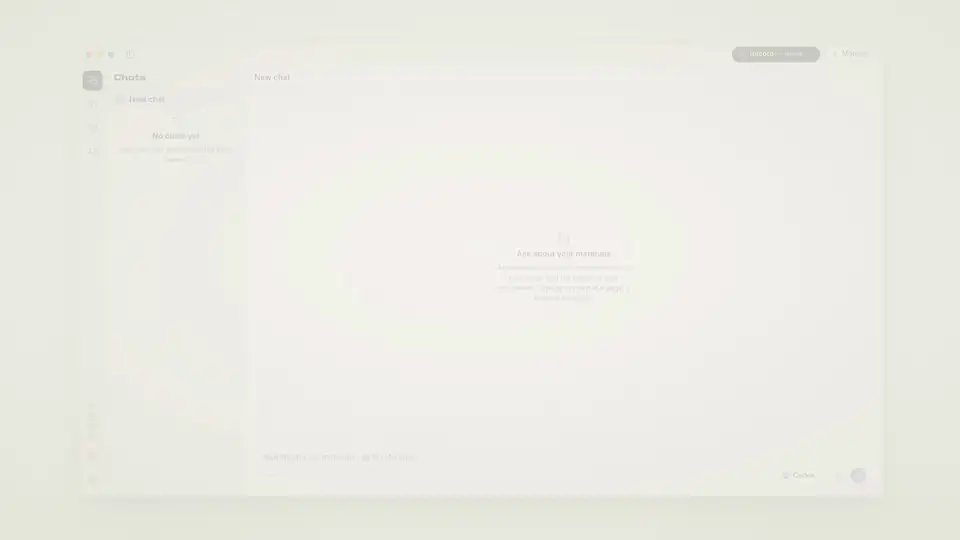
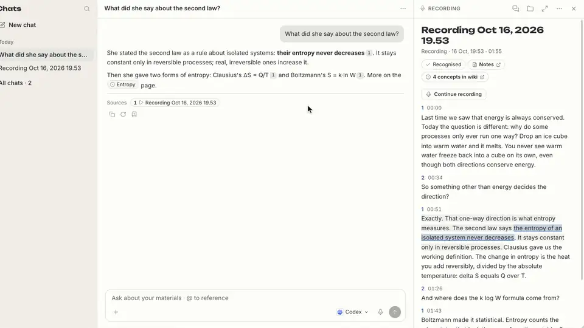
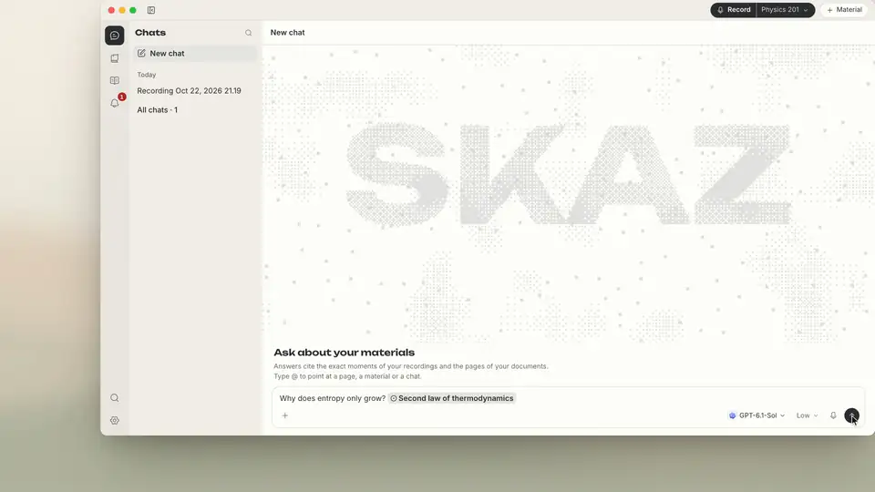
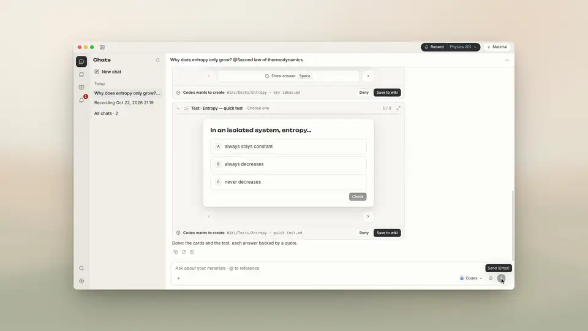
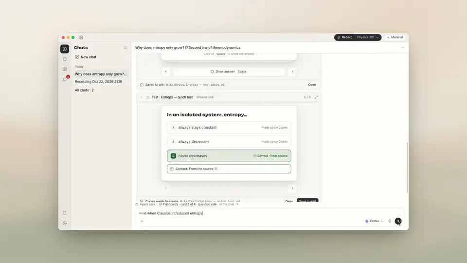
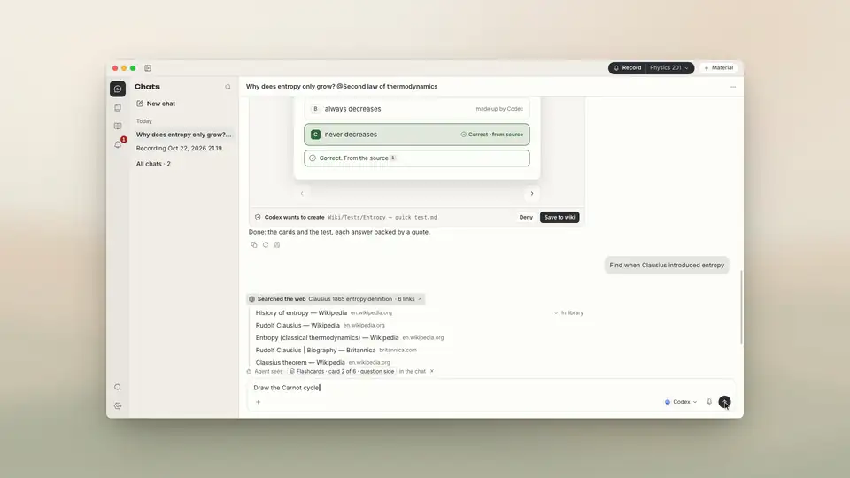
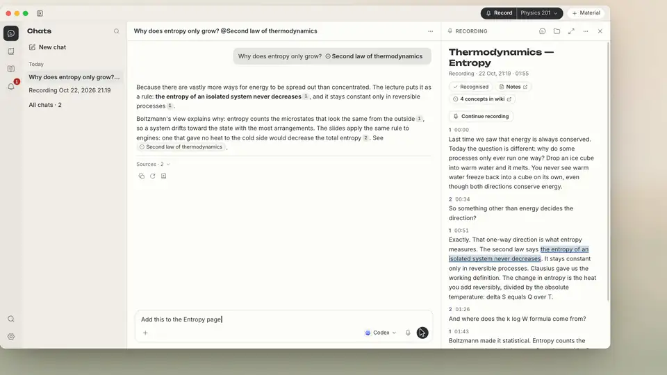
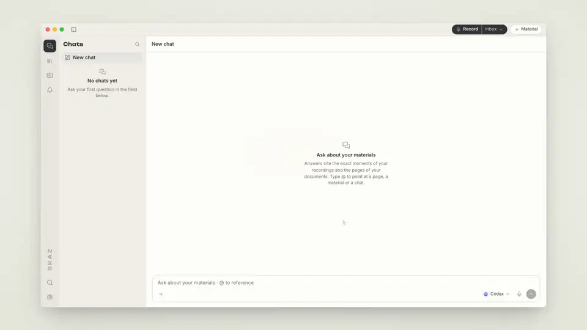
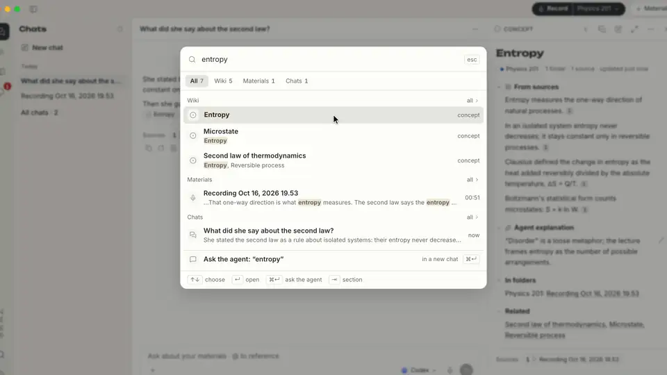

<div align="center">


# SKAZ

### Turn information into knowledge you can build on

Organize and connect · understand and learn · revisit and explore

[](https://github.com/all0b0y/SKAZ/releases/latest)


[](LICENSE)

**English** · [Русский](docs/i18n/README.ru.md) · [Español](docs/i18n/README.es.md) · [Deutsch](docs/i18n/README.de.md) · [简体中文](docs/i18n/README.zh-CN.md)

<br>



<sub>Product tour · demo profile with authored data · <a href="docs/images/skaz-tour.mp4">The whole tour in Full HD (MP4, 80 s)</a></sub>

<br><br>

[**Install**](#-install) · [**Workflow**](#-from-information-to-knowledge) · [**Features**](#-features) · [**Privacy**](#-privacy-and-data) · [**How it works**](#-how-it-works) · [**Contributing**](CONTRIBUTING.md)

</div>

---

SKAZ is a macOS app for organizing information, understanding it and keeping what you learn
within reach. Bring files, articles, notes, videos or recorded speech into a connected knowledge
base. Ask questions with references to your sources, learn with flashcards and tests, revisit
what you studied, and explore new sources to build on what you know.

Your materials and wiki live as plain Markdown files in a folder you choose.

> [!WARNING]
> **Alpha / early access.** Expect bugs and breaking changes, including changes to stored
> data. Back up important exports. SKAZ targets macOS on Apple Silicon; Windows, Linux and
> Intel Macs are not verified. The interface is English-only for now.

## 💡 Why SKAZ

Saving information does not make it easy to understand, remember or use. A useful explanation
gets buried in a chat, notes lose their context, and a topic you once understood becomes hard to
pick up again.

SKAZ brings your sources, a connected wiki, questions and study into the same place. Follow an
idea across materials, work through an explanation, test your understanding and return to the
source when you need a refresher. Add another perspective without leaving what you already know
behind.

AI can be wrong. Citations help you check an answer; they don't guarantee it is correct.

## 🧭 From information to knowledge

### 1. Collect

Start with a PDF, an article, your own text, a video or an audio file. You can also capture spoken
information live. These are different ways into the same library, not separate workflows.

### 2. Organize and understand

Turn materials into source notes and connected concept pages. Ask for an explanation, compare
ideas and follow citations back to the passage, page or timestamp. Source-backed statements,
connections inferred by the agent and its explanations are marked separately.

### 3. Learn and revisit

Ask for flashcards or a test based on a material, a wiki page or a chat. Save decks and tests to
the wiki, review saved cards with FSRS spaced repetition, and revisit difficult topics. The goal
is to keep useful knowledge available, not leave it in a document you never open again.

### 4. Explore further

Ask for additional sources through a web search you approve. Choose which results to add to the
library, connect them to your existing materials and continue exploring. Web results remain
separate from citations to your own library.

## 👀 See it in action

<table>
<tr>
<td width="50%"><br><b>Connect what you know</b><br>Source notes and concept pages bring related ideas together. See what comes from a source and what the agent inferred.</td>
<td width="50%"><br><b>Work through a question</b><br>Ask about your materials, follow an explanation and open its source references to check the context.</td>
</tr>
<tr>
<td width="50%"><br><b>Refresh what you learned</b><br>Make flashcards or a test from your materials. Save a deck and return to it with spaced repetition.</td>
<td width="50%"><br><b>Find another perspective</b><br>Approve a web query, review the results and choose which sources to add to your library.</td>
</tr>
<tr>
<td width="50%"><br><b>Make relationships visible</b><br>Answers can include diagrams, rendered on your Mac. Open them full size to explore the details.</td>
<td width="50%"><br><b>Stay in control</b><br>Review agent-proposed wiki edits before allowing them. Your own notes stay yours.</td>
</tr>
<tr>
<td width="50%"><br><b>Record into a folder</b><br>Pick the folder, press Record, and the transcript appears as people speak, by speaker and time.</td>
<td width="50%"><br><b>Light and dark</b><br>Follows your Mac, or pick a theme in <b>Settings → Appearance</b>.</td>
</tr>
</table>

<sub>Built from SKAZ 0.3.1's own interface (its HTML and CSS) with <a href="https://github.com/heygen-com/hyperframes">HyperFrames</a>.

The lecture, the slides, the answers, the cards and the web results are authored demonstration data,
not real speech recognition, AI output or search.</sub>

## ✨ Features

| | |
|---|---|
| 📚 **Bring your sources together** | PDFs, text and Markdown files, pasted text, web articles, audio and video files, and video links from YouTube, VK Video, RuTube and Vimeo. Use only material you are allowed to process. |
| 🧠 **A connected knowledge base** | Source notes, shared concept pages across folders and saved analyses form one wiki. Source-backed statements, inferred connections and agent explanations are marked separately. When sources disagree, both versions are shown and you decide. |
| 💬 **Understand, with sources** | Ask about the whole library, compare ideas or revisit an explanation. Citations open the relevant passage, document page or timestamp. Use **@** to point at a page, a material or a chat. Answers can include diagrams with a full-size viewer. |
| 🃏 **Learn and revisit** | Create flashcards and tests from a page, a material or a chat, with correct answers backed by checked source quotes. Save decks and tests to the wiki; saved cards use **FSRS spaced repetition**. Review what is due, practice difficult cards or return to a topic. |
| 🌐 **Explore beyond your library** | Search for additional sources from a chat. You see the exact query and choose Allow once, Allow in this chat or Deny; only the query is sent to the search. Review the results and add a chosen page to the library with one click. |
| 🗂️ **Keep your knowledge accessible** | Your materials and wiki are a folder of `.md` files. Open it in **Obsidian**, or export as plain Markdown with source footnotes. Your own edits to wiki pages are protected from the agent. |
| 🎙️ **Live recording** | Microphone, optionally with your Mac's sound (Zoom, videos; macOS 14.2+ and OS permission). Recognition with **Soniox** (cloud streaming, speaker separation, translation) or **Whisper on this computer** (works offline). SKAZ never silently switches services. |
| 🤖 **Your agent** | **Codex**, **Claude Code**, **Hermes Agent** or **OpenCode**, with your own subscription or key; SKAZ can install them for you. Agents read the library through SKAZ's tools and change wiki pages only after you allow it, with Undo; your own notes are never touched. Pick a model per chat and star favorites. Small filing decisions can run on a local model or through OpenRouter. |
| ✍️ **Recognition fixes** | An optional check finds likely recognition errors, fixes the confident ones and only highlights the doubtful ones. Every fix can be undone. |
| 🔄 **Updates** | SKAZ checks GitHub releases at start and once a day and installs a verified update from **Settings → About**. |

## 📦 Install

Paste this into Terminal (Apple Silicon, macOS 13 or later):

```bash
curl -fsSL https://raw.githubusercontent.com/all0b0y/SKAZ/main/install.sh | bash
```

The [script](install.sh) downloads the latest release, checks its SHA-256 checksum and SKAZ's
signature, installs SKAZ into Applications and opens it. Run the same command to update — your
library and settings stay where they are. SKAZ is not notarized by Apple yet; an app installed
this way opens without the "Apple could not verify…" warning.

<details>
<summary><b>Install from the DMG or PKG instead</b></summary>
<br>

Download `SKAZ-<version>-arm64.dmg` (or the `.pkg` installer) from
[GitHub Releases](https://github.com/all0b0y/SKAZ/releases/latest), open it and drag SKAZ to
Applications. On the first launch macOS says it could not verify SKAZ: click **Done**, not
Move to Trash. Then open **System Settings → Privacy & Security** and click **Open Anyway**
next to the message about SKAZ. This is needed once per downloaded build. Do not disable macOS
security protections globally.

</details>

Want to run the current code instead? See the [development setup](CONTRIBUTING.md).

### 🚀 First launch

1. **Agent.** Choose Codex, Claude Code, Hermes Agent or OpenCode and sign in with your own account.
   SKAZ can install the agent for you. Provider eligibility, limits and charges apply.
2. **Speech (optional).** If you work with audio, add a Soniox key and allow sending audio to
   Soniox — or pick **Whisper on this computer** and download a speech model (its size is shown
   first; no key needed). Text materials do not require speech recognition.
3. **Library.** Choose where the library lives; SKAZ suggests a folder in Documents.
4. **Start with a material.** Use **+ Material** to add a file, a link or text. Ask about it in
   the chat and open **Wiki** to explore its notes and concepts. Use **Record** when you want
   to capture speech; pick the folder next to it.
5. **Come back to what you learn.** Ask for flashcards or a test, save them to the wiki and return
   for a review or a deeper explanation.

Every choice can be changed later in **Settings**.

> [!IMPORTANT]
> Get consent before recording other people. Soniox, the agents and OpenRouter have their own
> pricing and policies; the MIT license does not cover their usage.

## 🔒 Privacy and data

| What | Where it lives / goes |
|---|---|
| Materials and wiki | Plain `.md` files in the library folder you chose. |
| Index, chats, settings | Local files in SKAZ's own app folder. |
| Live audio | Not kept as an archive for playback. Temporary audio may be used for processing or recovery. |
| Speech recognition | **Soniox:** audio is sent after your consent, which you can take back at any time. **Whisper on this computer:** audio never leaves your Mac. |
| Agent | Your question and the parts of the library it reads go to the agent you chose; its retention and training policies apply. |
| Web search | Only a query you approved, sent to the search of the agent named on the card — no chat history, no library text. Adding a found page makes one request to that address. |
| Keys | An encrypted local file in SKAZ's app folder, with its encryption key beside it. File permissions are the main boundary — not protection from processes running as your user. |
| Activity log | Kept without conversation text or keys. |
| Backend | Python, loopback-only, with a fresh token on every launch. |

Text from your sources is data, never instructions: a passage that addresses an AI is left out of
the wiki, and SKAZ tells you, with a way to bring it back.
**Local storage does not mean offline processing.** Protect exports and backups too.
See the [security policy](SECURITY.md) for limitations and the reporting channel.

## 🧩 How it works

Speech recognition is one input path. Materials, the wiki, answers and study share the same library.

```text
Files / text / links / speech → Electron + React ↔ Python
                                                    ├─ Soniox | local Whisper (speech only)
                                                    ├─ Materials/*.md + Wiki/*.md
                                                    └─ SKAZ tools ↔ your chosen agent
                                                                         ↓
                                                       Answers · connections · cards · tests
```

| Layer | Stack |
|---|---|
| Desktop | Electron |
| Interface | React, TypeScript, CodeMirror |
| Local backend | Python, FastAPI, an SQLite index over the Markdown files |

## 🗺️ What's next

- [ ] Apple notarization for releases
- [ ] Illustrated answers and notes from PDF presentations
- [ ] Broader real-world validation

## 🤝 Contributing

[Contributing](CONTRIBUTING.md) covers setup, tests and pull requests; [Packaging](docs/PACKAGING.md)
covers building installers. Small fixes can go straight to a PR — please discuss larger changes in
an issue first. Release notes live in [GitHub Releases](https://github.com/all0b0y/SKAZ/releases).

[Community rules](CODE_OF_CONDUCT.md) · [Security policy](SECURITY.md) · [MIT license](LICENSE)

---

<div align="center">
<sub><i>Skaz</i> (сказ) is a Russian word for a spoken narrative. Formerly AudioHelper.<br>
Copyright © 2026 all0b0y.</sub>
</div>
