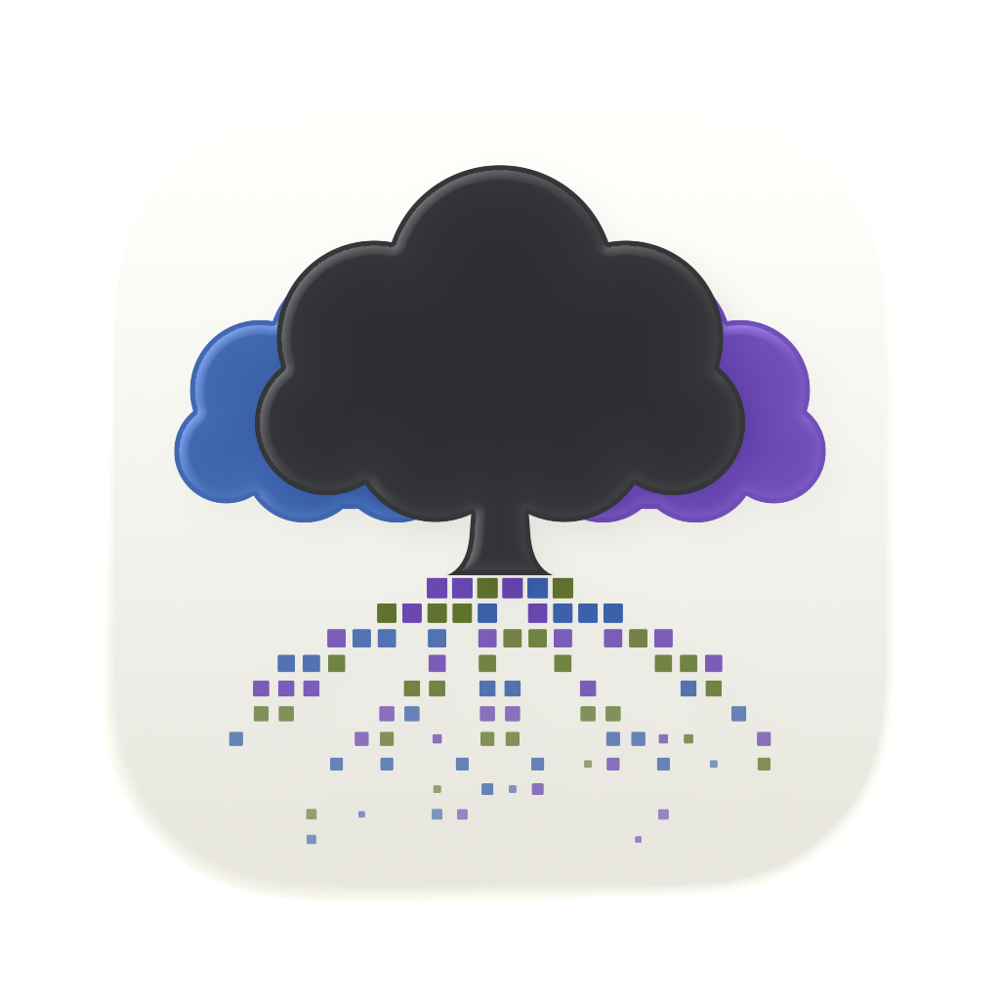
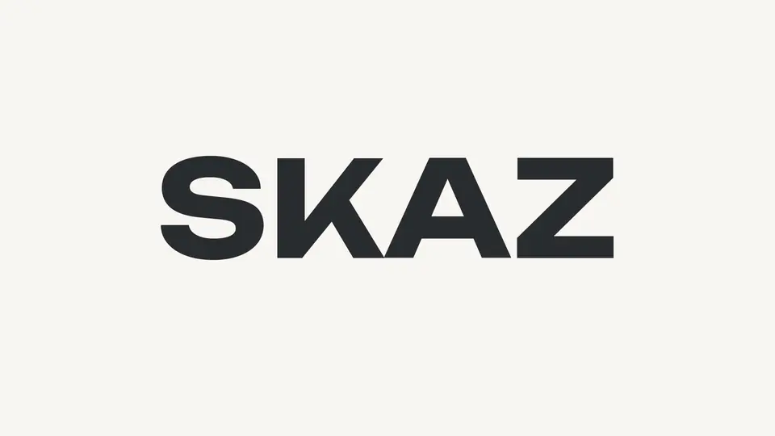
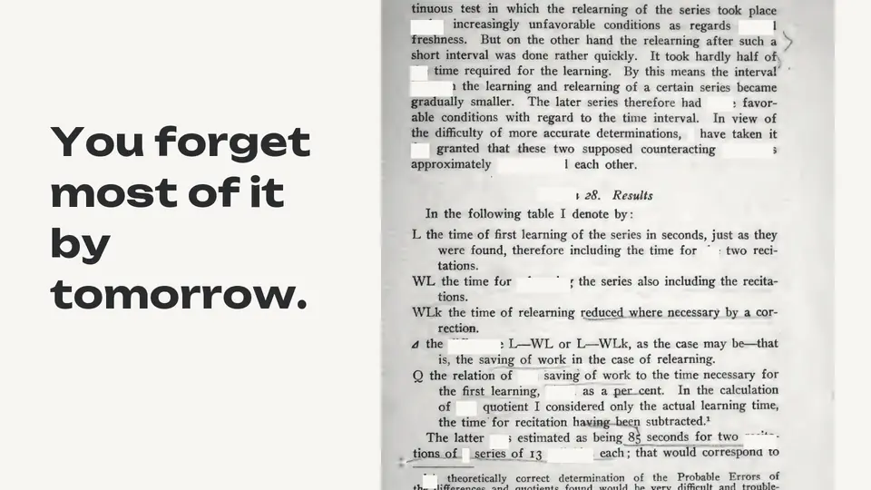
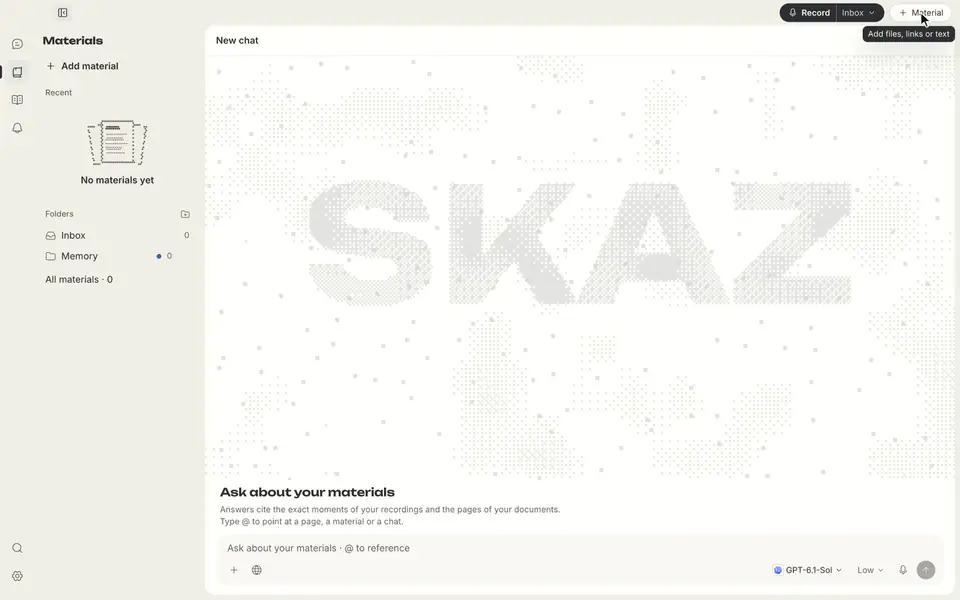
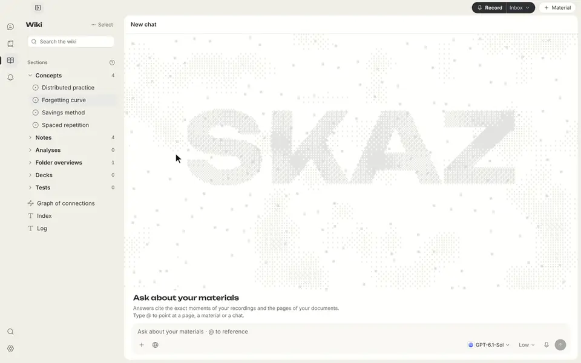
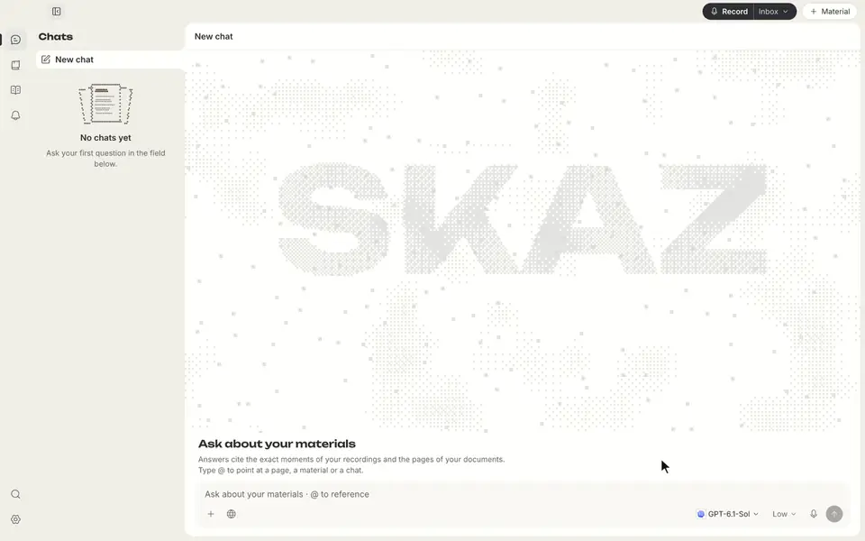
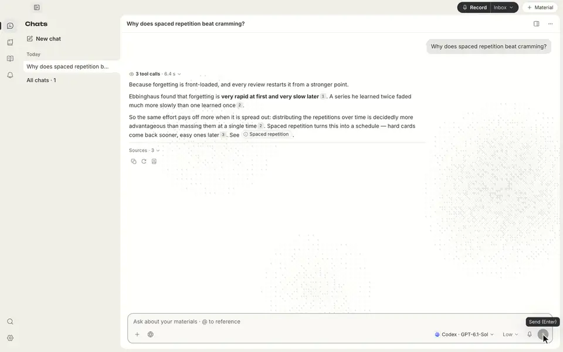
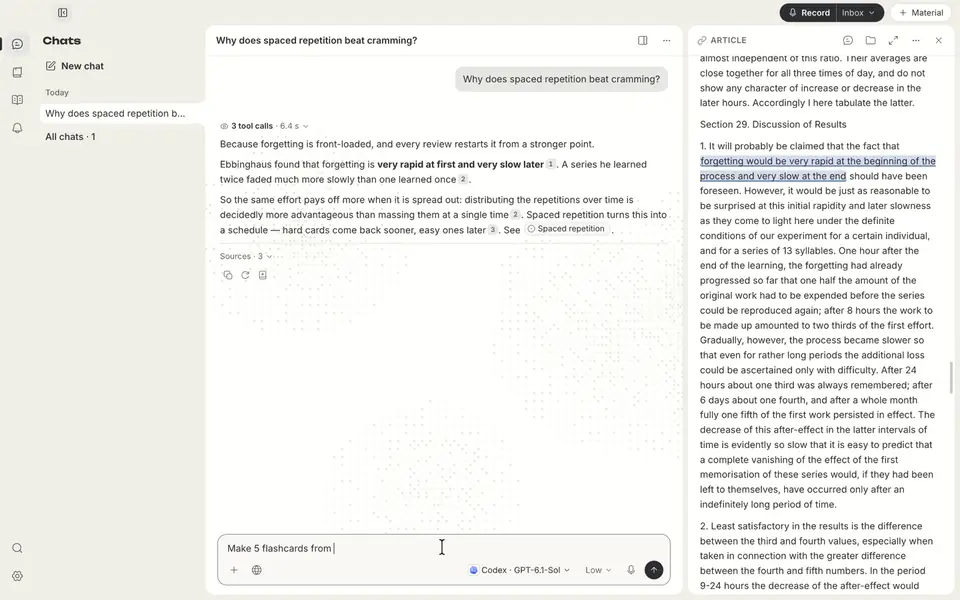

<div align="center">



# SKAZ

### Aus Informationen wird Wissen, auf dem du aufbauen kannst

Sammeln und verknüpfen · verstehen und lernen · wiederholen und weiterdenken

[](https://github.com/all0b0y/SKAZ/releases/latest)


[](../../LICENSE)

[English](../../README.md) · [Русский](README.ru.md) · [Español](README.es.md) · **Deutsch** · [简体中文](README.zh-CN.md)

<br>

<a href="../images/skaz-intro.mp4"></a>

<sub>Intro ohne Ton · <a href="../images/skaz-intro.mp4">MP4, 3 s</a></sub>

<br><br>

[**Installation**](#-installation) · [**So nutzt du SKAZ**](#-von-informationen-zu-wissen) · [**Funktionen**](#-funktionen) · [**Datenschutz**](#-datenschutz-und-daten) · [**Aufbau**](#-aufbau) · [**Mitmachen**](../../CONTRIBUTING.md)

</div>

---

SKAZ ist eine macOS-App, mit der du Informationen ordnest, Zusammenhänge verstehst und Gelerntes
wieder aufgreifst. Bringe Dateien, Artikel, Notizen, Videos oder gesprochene Inhalte in einer
vernetzten Wissensbasis zusammen. Stelle Fragen mit Verweisen auf deine Quellen, lerne mit
Karteikarten und Tests, wiederhole Gelerntes und erweitere dein Wissen mit neuen Quellen.

Deine Materialien und dein Wiki liegen als Markdown-Dateien in einem Ordner deiner Wahl.

> [!WARNING]
> **Alpha / Early Access.** Rechne mit Fehlern und inkompatiblen Änderungen, auch an gespeicherten
> Daten. Sichere wichtige Exporte. SKAZ ist für macOS auf Apple Silicon gedacht; Windows, Linux und
> Intel-Macs sind nicht geprüft. Die Oberfläche gibt es vorerst nur auf Englisch.

## 💡 Warum SKAZ

<p align="center"><a href="../images/skaz-forget.mp4"></a></p>

Informationen zu speichern heißt noch nicht, sie zu verstehen, zu behalten oder nutzen zu können.
Eine hilfreiche Erklärung verschwindet im Chat, Notizen verlieren ihren Kontext, und der Einstieg
in ein früher vertrautes Thema fällt zunehmend schwer.

SKAZ bringt Quellen, ein vernetztes Wiki, Fragen und Lernen an einem Ort zusammen. Verfolge eine
Idee durch verschiedene Materialien, arbeite eine Erklärung durch, prüfe dein Verständnis und
kehre zum Auffrischen zur Quelle zurück. Neue Perspektiven ergänzen dein vorhandenes Wissen,
und du musst nicht jedes Mal bei null anfangen.

KI kann sich irren. Belege helfen, eine Antwort zu prüfen; sie garantieren nicht, dass sie stimmt.

## 🧭 Von Informationen zu Wissen

### 1. Sammeln

Beginne mit einem PDF, einem Artikel, eigenem Text, einem Video oder einer Audiodatei. Gesprochene
Inhalte kannst du auch live aufnehmen. Das sind verschiedene Wege in dieselbe Bibliothek,
keine getrennten Arbeitsabläufe.

### 2. Ordnen und verstehen

Mache aus Materialien Quellennotizen und verknüpfte Begriffsseiten. Lass dir Zusammenhänge erklären,
vergleiche Ideen und folge Belegen zur Passage, Seite oder Zeitmarke. Quellenbasierte Aussagen,
vom Agenten erschlossene Verbindungen und seine Erklärungen sind getrennt gekennzeichnet.

### 3. Lernen und wiederholen

Bitte um Karteikarten oder einen Test zu einem Material, einer Wiki-Seite oder einem Chat.
Speichere Stapel und Tests im Wiki, wiederhole gespeicherte Karten mit dem FSRS-Algorithmus und
kehre zu schwierigen Themen zurück. Nützliches Wissen soll verfügbar bleiben, statt in einem
Dokument zu liegen, das du nie wieder öffnest.

### 4. Wissen erweitern

Suche mit einer von dir erlaubten Websuche nach weiteren Quellen. Wähle aus, welche Ergebnisse
in die Bibliothek kommen, verknüpfe sie mit deinen Materialien und forsche weiter. Web-Ergebnisse
bleiben von Belegen aus deiner eigenen Bibliothek getrennt.

## 👀 So sieht es aus

<p align="center"><a href="../images/skaz-read.mp4"></a></p>

### Quellen sammeln

Füge ein PDF, Webartikel und eigene Texte derselben Bibliothek hinzu.

<a href="../images/demo-collect.mp4"></a>

### Wissen verknüpfen

Erkunde Quellennotizen und verknüpfte Begriffsseiten. Erkenne, was aus einer Quelle stammt und was der Agent erschlossen hat.

<a href="../images/demo-connect.mp4"></a>

### Fragen durchgehen

Frage zu deinen Materialien und folge einer Erklärung mit Quellenverweisen.

<a href="../images/demo-ask.mp4"></a>

### Die Quelle prüfen

Öffne einen Beleg an der zitierten Passage und lies den ursprünglichen Zusammenhang.

<a href="../images/demo-source.mp4"></a>

### Gelerntes auffrischen

Erstelle Karten aus deinen Materialien, decke eine Antwort auf und prüfe dein Wissen.

<a href="../images/demo-learn.mp4"></a>

<sub>Aufnahmen von SKAZ 0.3.2 in einem isolierten Demoprofil. Notizen, Agentenantworten und Karten sind
vorbereitete Demodaten, keine live erzeugten KI-Ausgaben. Alle Animationen und MP4s sind ohne Ton;
klicke auf eine Aufnahme, um ihre MP4 in voller Größe zu öffnen.</sub>

## ✨ Funktionen

| | |
|---|---|
| 📚 **Quellen zusammenbringen** | PDFs, Text- und Markdown-Dateien, eingefügter Text, Webartikel, Audio- und Videodateien sowie Videolinks von YouTube, VK Video, RuTube und Vimeo. Verwende nur Material, das du verarbeiten darfst. |
| 🧠 **Eine vernetzte Wissensbasis** | Quellennotizen, gemeinsame Begriffsseiten über Ordner hinweg und gespeicherte Analysen bilden ein Wiki. Quellenbasierte Aussagen, erschlossene Verbindungen und Erklärungen des Agenten sind getrennt gekennzeichnet. Bei widersprüchlichen Quellen werden beide Fassungen gezeigt, und du entscheidest. |
| 💬 **Verstehen mit Quellen** | Frage zur ganzen Bibliothek, vergleiche Ideen oder greife eine Erklärung wieder auf. Belege öffnen die passende Passage, Dokumentseite oder Zeitmarke. Mit **@** verweist du auf eine Seite, ein Material oder einen Chat. Antworten können Diagramme mit einer Ansicht in voller Größe enthalten. |
| 🃏 **Lernen und wiederholen** | Erstelle Karteikarten und Tests aus einer Seite, einem Material oder einem Chat; richtige Antworten sind durch geprüfte Quellenzitate belegt. Speichere Stapel und Tests im Wiki. Gespeicherte Karten verwenden **FSRS für zeitlich verteilte Wiederholung**. Wiederhole fällige Inhalte, übe schwierige Karten oder greife ein Thema wieder auf. |
| 🌐 **Über die Bibliothek hinaus** | Suche im Chat nach weiteren Quellen. Du siehst die genaue Anfrage und wählst Allow once, Allow in this chat oder Deny; an die Suche geht nur die Anfrage. Prüfe die Ergebnisse und füge eine ausgewählte Seite mit einem Klick zur Bibliothek hinzu. |
| 🗂️ **Dein Wissen bleibt zugänglich** | Materialien und Wiki liegen in einem Ordner mit `.md`-Dateien. Öffne ihn in **Obsidian** oder exportiere als Markdown mit Quellenfußnoten. Deine eigenen Änderungen an Wiki-Seiten sind vor dem Agenten geschützt. |
| 🎙️ **Live-Aufnahme** | Mikrofon, auf Wunsch zusammen mit dem Ton des Macs (Zoom, Videos; macOS 14.2+ und Systemberechtigung nötig). Erkennung mit **Soniox** (Cloud-Streaming, Sprechertrennung, Übersetzung) oder **Whisper auf diesem Computer** (funktioniert offline). SKAZ wechselt den Dienst nie stillschweigend. |
| 🤖 **Dein Agent** | **Codex**, **Claude Code**, **Hermes Agent** oder **OpenCode**, mit deinem eigenen Abo oder Schlüssel; SKAZ kann sie für dich installieren. Agenten lesen die Bibliothek über SKAZ-Werkzeuge und ändern Wiki-Seiten nur, wenn du es erlaubst, mit Undo; deine eigenen Notizen bleiben unberührt. Wähle ein Modell pro Chat und markiere Favoriten mit einem Stern. Kleine Ablageentscheidungen können ein lokales Modell oder OpenRouter übernehmen. |
| ✍️ **Erkennungskorrekturen** | Eine optionale Prüfung findet wahrscheinliche Erkennungsfehler, korrigiert die sicheren und markiert die zweifelhaften nur. Jede Korrektur lässt sich rückgängig machen. |
| 🔄 **Updates** | SKAZ prüft GitHub-Releases beim Start und einmal am Tag und installiert ein geprüftes Update über **Settings → About**. |

## 📦 Installation

Füge das ins Terminal ein (Apple Silicon, macOS 13 oder neuer):

```bash
curl -fsSL https://raw.githubusercontent.com/all0b0y/SKAZ/main/install.sh | bash
```

Das [Skript](../../install.sh) lädt das neueste Release, prüft die SHA-256-Prüfsumme und die
Signatur von SKAZ, installiert SKAZ in „Programme" und öffnet es. Zum Aktualisieren denselben
Befehl erneut ausführen – Bibliothek und Einstellungen bleiben erhalten. SKAZ ist noch nicht von
Apple notarisiert; so installiert öffnet sich die App ohne die Warnung „Apple konnte nicht
überprüfen …".

<details>
<summary><b>Stattdessen per DMG oder PKG installieren</b></summary>
<br>

Lade `SKAZ-<version>-arm64.dmg` (oder das `.pkg`-Installationsprogramm) von
[GitHub Releases](https://github.com/all0b0y/SKAZ/releases/latest), öffne es und ziehe SKAZ in
„Programme". Beim ersten Start meldet macOS, dass SKAZ nicht überprüft werden konnte: Klicke auf
**Fertig**, nicht auf „In den Papierkorb legen". Öffne dann **Systemeinstellungen → Datenschutz &
Sicherheit** und klicke neben der Meldung zu SKAZ auf **Dennoch öffnen**. Das ist einmal pro
heruntergeladenem Build nötig. Schalte die Schutzfunktionen von macOS nicht global ab.

</details>

Lieber den aktuellen Code ausführen? Siehe [Entwicklungs-Setup](../../CONTRIBUTING.md).

### 🚀 Erster Start

1. **Agent.** Wähle Codex, Claude Code, Hermes Agent oder OpenCode und melde dich mit deinem eigenen Konto
   an. SKAZ kann den Agenten für dich installieren. Es gelten Bedingungen, Limits und Kosten des Anbieters.
2. **Spracherkennung (optional).** Wenn du mit Audio arbeitest, füge einen Soniox-Schlüssel hinzu
   und erlaube das Senden von Audio an Soniox. Alternativ wählst du **Whisper on this computer**
   und lädst ein Sprachmodell (Größe vorher sichtbar, kein Schlüssel nötig). Textmaterialien
   brauchen keine Spracherkennung.
3. **Bibliothek.** Wähle, wo sie liegt; SKAZ schlägt einen Ordner in „Dokumente" vor.
4. **Mit einem Material beginnen.** Füge über **+ Material** eine Datei, einen Link oder Text hinzu.
   Frage im Chat und öffne **Wiki**, um Notizen und Begriffe zu erkunden. Mit **Record** nimmst
   du gesprochene Inhalte auf; den Ordner wählst du daneben.
5. **Gelerntes wieder aufgreifen.** Bitte um Karteikarten oder einen Test, speichere sie im Wiki
   und kehre zum Wiederholen oder für eine ausführlichere Erklärung zurück.

Alles lässt sich später unter **Settings** ändern.

> [!IMPORTANT]
> Hol die Zustimmung ein, bevor du andere Menschen aufnimmst. Soniox, die Agenten und OpenRouter
> haben eigene Preise und Richtlinien; die MIT-Lizenz deckt deren Nutzung nicht ab.

## 🔒 Datenschutz und Daten

| Was | Wo es liegt / wohin es geht |
|---|---|
| Materialien und Wiki | Normale `.md`-Dateien im gewählten Bibliotheksordner. |
| Index, Chats, Einstellungen | Lokale Dateien im eigenen App-Ordner von SKAZ. |
| Live-Audio | Wird nicht als Archiv zum Abspielen aufbewahrt. Temporäres Audio kann zur Verarbeitung oder Wiederherstellung genutzt werden. |
| Spracherkennung | **Soniox:** Audio wird nach deiner Zustimmung gesendet, die du jederzeit zurücknehmen kannst. **Whisper auf diesem Computer:** Audio verlässt deinen Mac nie. |
| Agent | Deine Frage und die gelesenen Teile der Bibliothek gehen an den gewählten Agenten; dessen Aufbewahrungs- und Trainingsrichtlinien gelten. |
| Websuche | Nur eine von dir erlaubte Anfrage, an die Suche des auf der Karte genannten Agenten – ohne Chatverlauf und ohne Text aus der Bibliothek. Eine gefundene Seite hinzuzufügen ist eine einzige Anfrage an diese Adresse. |
| Schlüssel | Eine verschlüsselte lokale Datei im App-Ordner von SKAZ, der Schlüssel liegt daneben. Die Dateiberechtigungen sind die Hauptgrenze – kein Schutz vor Prozessen, die unter deinem Benutzer laufen. |
| Aktivitätsprotokoll | Ohne Gesprächstext und Schlüssel. |
| Backend | Python, nur Loopback, bei jedem Start mit neuem Token. |

Text aus deinen Quellen ist Daten, nie eine Anweisung: Eine Passage, die sich an eine KI richtet,
bleibt außerhalb des Wikis, und SKAZ sagt dir Bescheid – mit der Möglichkeit, sie zurückzuholen.
**Lokale Speicherung heißt nicht Offline-Verarbeitung.** Schütze auch Exporte und Backups.
Einschränkungen und Meldeweg stehen in der [Sicherheitsrichtlinie](../../SECURITY.md).

## 🧩 Aufbau

Spracherkennung ist ein Eingabeweg. Materialien, Wiki, Antworten und Lernen nutzen dieselbe Bibliothek.

```text
Dateien / Text / Links / Sprache → Electron + React ↔ Python
                                                        ├─ Soniox | lokales Whisper (nur Sprache)
                                                        ├─ Materials/*.md + Wiki/*.md
                                                        └─ SKAZ-Werkzeuge ↔ gewählter Agent
                                                                                 ↓
                                                           Antworten · Verbindungen · Karten · Tests
```

| Schicht | Technik |
|---|---|
| Desktop | Electron |
| Oberfläche | React, TypeScript, CodeMirror |
| Lokales Backend | Python, FastAPI, ein SQLite-Index über den Markdown-Dateien |

## 🗺️ Wie es weitergeht

- [ ] Notarisierung der Releases durch Apple
- [ ] Bebilderte Antworten und Notizen aus PDF-Präsentationen
- [ ] Breitere Erprobung im Alltag

## 🤝 Mitmachen

[Contributing](../../CONTRIBUTING.md) beschreibt Setup, Tests und Pull Requests;
[Packaging](../PACKAGING.md) den Bau der Installationsprogramme. Kleine Korrekturen können direkt
als PR kommen – größere Änderungen bitte zuerst in einem Issue besprechen. Release Notes stehen in
[GitHub Releases](https://github.com/all0b0y/SKAZ/releases).

[Community-Regeln](../../CODE_OF_CONDUCT.md) · [Sicherheitsrichtlinie](../../SECURITY.md) · [MIT-Lizenz](../../LICENSE)

---

<div align="center">
<sub><i>Skaz</i> (сказ) ist ein russisches Wort für eine mündliche Erzählung. Früher AudioHelper.<br>
Copyright © 2026 all0b0y.</sub>
</div>
