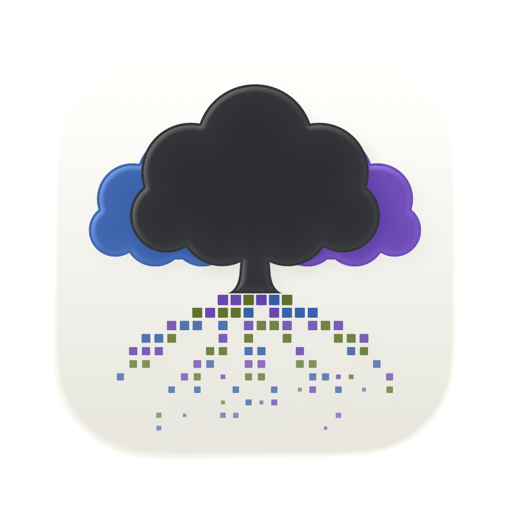
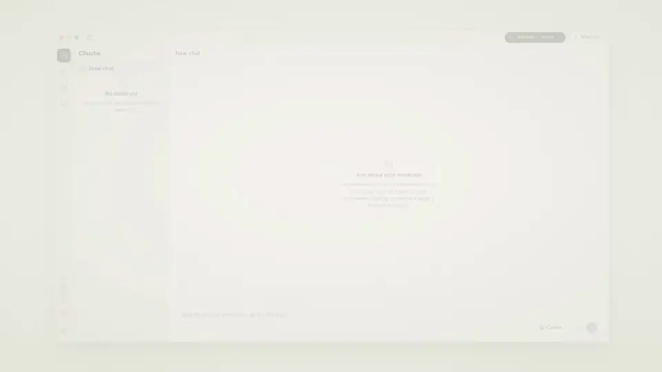
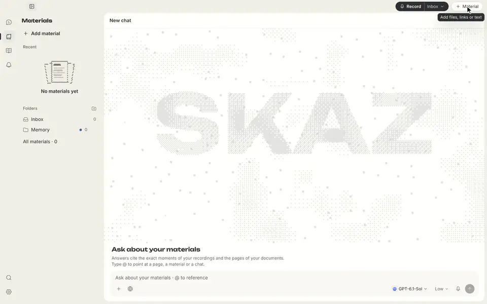
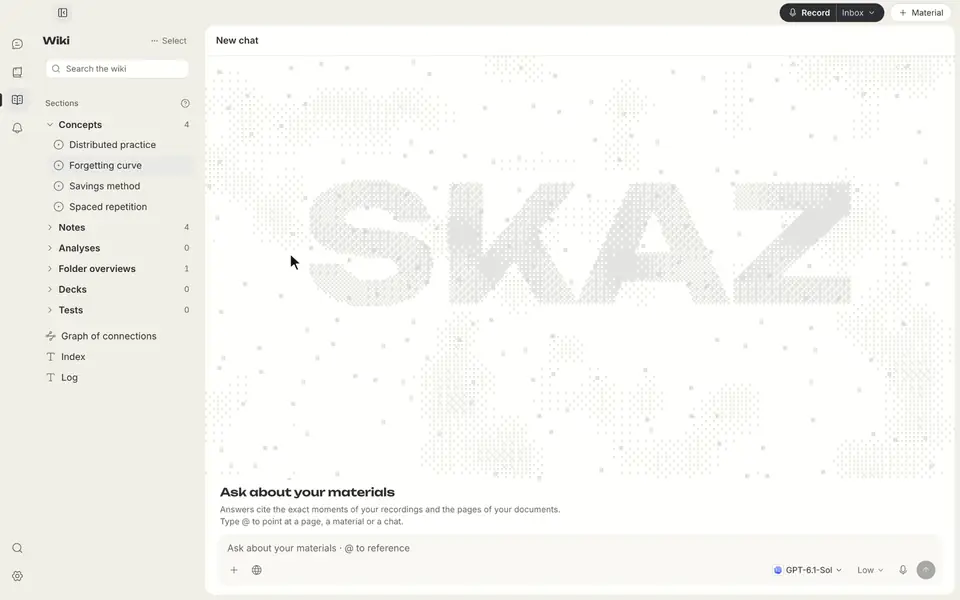
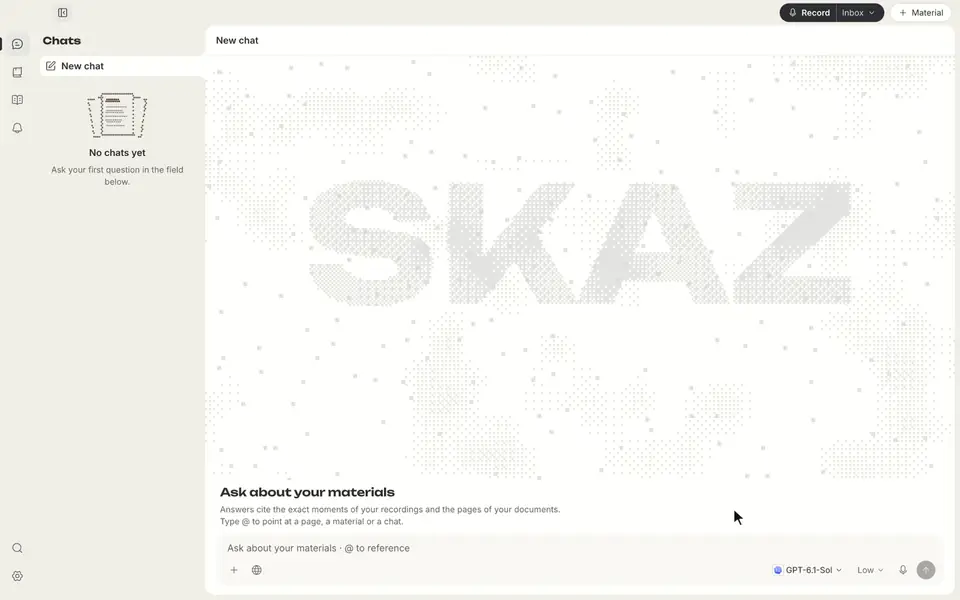
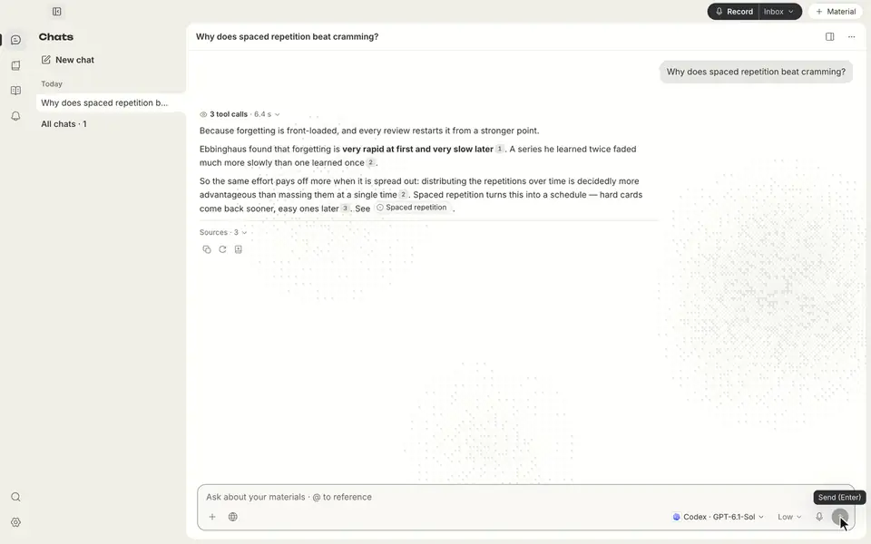
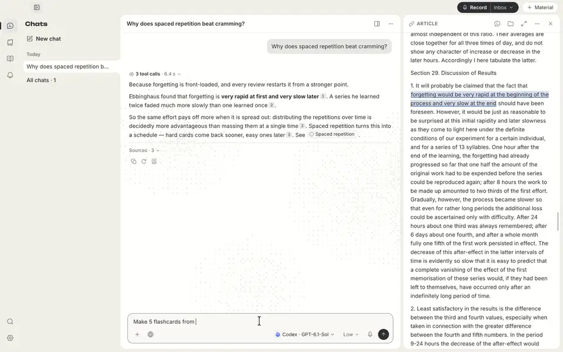

<div align="center">



# SKAZ

### Convierte la información en conocimiento que puedas seguir ampliando

Organiza y conecta · comprende y aprende · repasa y explora

[](https://github.com/all0b0y/SKAZ/releases/latest)


[](../../LICENSE)

[English](../../README.md) · [Русский](README.ru.md) · **Español** · [Deutsch](README.de.md) · [简体中文](README.zh-CN.md)

<br>



<sub>Recorrido de SKAZ 0.3.1 · interfaz anterior, no la de 0.3.2 · datos de demostración preparados · <a href="../images/skaz-tour.mp4">El recorrido completo en Full HD (MP4, 80 s)</a></sub>

<br><br>

[**Instalación**](#-instalación) · [**Cómo usarlo**](#-de-la-información-al-conocimiento) · [**Funciones**](#-funciones) · [**Privacidad**](#-privacidad-y-datos) · [**Cómo funciona**](#-cómo-funciona) · [**Contribuir**](../../CONTRIBUTING.md)

</div>

---

SKAZ es una app para macOS que te ayuda a organizar información, comprenderla y volver a lo que
has aprendido. Reúne archivos, artículos, notas, vídeos o contenido hablado en una base de
conocimiento conectada. Haz preguntas con referencias a tus fuentes, aprende con tarjetas y
tests, repasa lo estudiado y amplía lo que sabes con nuevas fuentes.

Tus materiales y tu wiki se guardan como archivos Markdown en la carpeta que tú elijas.

> [!WARNING]
> **Alfa / acceso anticipado.** Habrá errores y cambios incompatibles, también en los datos
> guardados. Haz copias de seguridad de las exportaciones importantes. SKAZ está pensado para macOS
> en Apple Silicon; Windows, Linux y los Mac con Intel no están verificados. Por ahora la interfaz
> solo está en inglés.

## 💡 Por qué SKAZ

<p align="center"><a href="../images/skaz-forget.mp4"></a></p>

Guardar información no basta para comprenderla, recordarla o utilizarla. Una buena explicación
queda enterrada en un chat, las notas pierden su contexto y cuesta retomar un tema que antes
entendías.

SKAZ reúne fuentes, una wiki conectada, preguntas y estudio en un mismo lugar. Sigue una idea a
través de distintos materiales, trabaja una explicación, comprueba lo que has entendido y vuelve
a la fuente cuando necesites refrescarlo. Añade otra perspectiva sin empezar desde cero.

La IA puede equivocarse. Las citas ayudan a comprobar una respuesta; no garantizan que sea correcta.

## 🧭 De la información al conocimiento

### 1. Reúne

Empieza con un PDF, un artículo, un texto propio, un vídeo o un archivo de audio. También puedes
capturar contenido hablado en directo. Son distintas formas de alimentar la misma biblioteca,
no flujos separados.

### 2. Organiza y comprende

Convierte los materiales en apuntes y páginas de conceptos conectadas. Pide explicaciones,
compara ideas y sigue las citas hasta el pasaje, la página o el instante original. Las afirmaciones
apoyadas en fuentes, las conexiones deducidas por el agente y sus explicaciones se marcan por separado.

### 3. Aprende y repasa

Pide tarjetas o un test a partir de un material, una página de la wiki o un chat. Guarda barajas y
tests en la wiki, repasa las tarjetas guardadas con repetición espaciada FSRS y vuelve a los temas
difíciles. La idea es mantener el conocimiento a mano, no dejarlo en un documento que no abrirás
nunca más.

### 4. Amplía lo que sabes

Busca fuentes adicionales mediante una búsqueda web que tú apruebas. Elige qué resultados añadir
a la biblioteca, relaciónalos con tus materiales y sigue explorando. Los resultados web se mantienen
separados de las citas de tu propia biblioteca.

## 👀 Míralo en acción

<p align="center"><a href="../images/skaz-read.mp4"></a></p>

### Reúne tus fuentes

Añade un PDF, artículos web y tus propios textos a la misma biblioteca.

<a href="../images/demo-collect.mp4"></a>

### Conecta lo que sabes

Explora apuntes de las fuentes y páginas de conceptos conectadas. Distingue lo que dice una fuente de lo que dedujo el agente.

<a href="../images/demo-connect.mp4"></a>

### Resuelve tus dudas

Pregunta sobre tus materiales y sigue una explicación con referencias a tus fuentes.

<a href="../images/demo-ask.mp4"></a>

### Comprueba la fuente

Abre una cita en el pasaje correspondiente y lee el contexto original.

<a href="../images/demo-source.mp4"></a>

### Refresca lo aprendido

Crea tarjetas a partir de tus materiales, revela una respuesta y comprueba lo que sabes.

<a href="../images/demo-learn.mp4"></a>

<sub>Grabaciones de SKAZ 0.3.2 en un perfil de demostración aislado. Los apuntes, las respuestas del agente y las tarjetas
son datos de demostración preparados, no resultados de una IA en directo. Todas las animaciones y los MP4 son sin sonido;
haz clic en una grabación para abrir su MP4 a tamaño completo.</sub>

## ✨ Funciones

**Actualizado para 0.3.2.** El recorrido y las animaciones anteriores muestran la interfaz de 0.3.1, no la de 0.3.2.

| | |
|---|---|
| 📚 **Tus fuentes, juntas** | PDF, archivos de texto y Markdown, texto pegado, artículos web, archivos de audio y vídeo, y enlaces de vídeo de YouTube, VK Video, RuTube y Vimeo. Usa solo material que tengas permiso para procesar. |
| 🧠 **Una base de conocimiento conectada** | Apuntes de las fuentes, páginas de conceptos compartidas entre carpetas y análisis guardados forman una sola wiki. Las afirmaciones apoyadas en fuentes, las conexiones deducidas y las explicaciones del agente se marcan por separado. Si las fuentes discrepan, se muestran ambas versiones y decides tú. |
| 💬 **Comprende con fuentes** | Pregunta sobre toda la biblioteca, compara ideas o vuelve a una explicación. Las citas abren el pasaje, la página o el instante correspondiente. Usa **@** para señalar una página, un material o un chat. Las respuestas pueden incluir diagramas con un visor a tamaño completo. |
| 🃏 **Aprende y repasa** | Crea tarjetas y tests a partir de una página, un material o un chat, con respuestas correctas respaldadas por citas comprobadas. Guarda barajas y tests en la wiki; las tarjetas guardadas usan **repetición espaciada FSRS**. Repasa lo que toca, practica las tarjetas difíciles o retoma un tema. |
| 🌐 **Explora más allá de tu biblioteca** | Busca fuentes adicionales desde un chat. Ves la consulta exacta y eliges Allow once, Allow in this chat o Deny; a la búsqueda solo se envía la consulta. Revisa los resultados y añade una página elegida a la biblioteca con un clic. |
| 🗂️ **Conserva el acceso a lo que sabes** | Tus materiales y tu wiki son una carpeta de archivos `.md`. Ábrela en **Obsidian** o exporta a Markdown con notas al pie que remiten a las fuentes. Tus propias ediciones de la wiki están protegidas frente al agente. |
| 🎙️ **Grabación en vivo** | Micrófono y, si quieres, el sonido del Mac (Zoom, vídeos; requiere macOS 14.2+ y permiso del sistema). Reconocimiento con **Soniox** (en la nube y en streaming, separación de hablantes, traducción) o **Whisper en este ordenador** (funciona sin conexión). SKAZ nunca cambia de servicio sin avisar. |
| 📚 **Cualquier fuente** | PDF, documentos, archivos de texto y Markdown, audio y vídeo, artículos web (limpios), texto pegado de cualquier longitud y enlaces de vídeo de YouTube, VK Video, RuTube y Vimeo. Usa solo material que tengas permiso para procesar. |
| 🧠 **Una wiki viva** | Apuntes de cada fuente, una página por concepto para todas las carpetas y análisis guardados. Cada afirmación está marcada: cita de una fuente, conexión deducida por el agente o explicación del agente. Cuando las fuentes no coinciden, se muestran ambas versiones y decides tú. |
| 💬 **Chats con notas al pie** | Pregunta sobre toda la biblioteca o limita un chat a fuentes seleccionadas en **Search & sources**, con exclusiones para ese chat. Las notas abren el momento exacto de una grabación o la página de un documento. Señala una página, un material o un chat con **@**. |
| 🧱 **Respuestas estructuradas** | Comparaciones con columnas de ancho ajustable, líneas de tiempo, pasos, definiciones, tarjetas de conceptos, cifras clave y diagramas. Los enlaces a fuentes acompañan a los elementos que respaldan. Copia un bloque como Markdown o selecciona un elemento para preguntar sobre él. |
| 🃏 **Tarjetas y tests** | Pide tarjetas o un test sobre una página, un material o un chat. Cada respuesta correcta se apoya en una cita comprobada. Las tarjetas se repasan con repetición espaciada FSRS; las barajas y los tests se pueden guardar en la wiki. |
| 🌐 **Búsqueda web, con tu permiso** | Ves la consulta exacta antes de enviarla y eliges Allow once, Allow in this chat o Deny. Los resultados muestran las reglas de sitios vigentes; tú decides si añades una página a la biblioteca. |
| 🧪 **Search Beta** | Activa **Beta search features** en **Settings → Search** para usar **Only these sites** (una restricción) y **Prefer** (una preferencia). Está desactivado por defecto; al desactivarlo se pausan estas reglas para nuevas búsquedas, pero se conservan las listas. **Never** y los filtros de fuentes de la biblioteca siguen activos. |
| 📖 **Lectura de páginas web** | El agente puede leer páginas públicas de resultados de búsqueda aprobados sin importarlas primero. Las páginas largas se leen en partes acotadas de la misma instantánea. **Add to library** es una acción aparte; leer no añade un material. |
| 🤖 **Tu agente** | **Codex**, **Claude Code**, **Hermes Agent** u **OpenCode**, con tu propia suscripción o clave; SKAZ puede instalarlos por ti. Los agentes leen la biblioteca con herramientas de SKAZ y cambian páginas de la wiki solo cuando lo permites, con Undo; tus propias notas nunca se tocan. Elige un modelo por chat y marca tus favoritos con una estrella. Las pequeñas decisiones de organización pueden ir a un modelo local o a OpenRouter. |
| ✍️ **Corrección del reconocimiento** | Una revisión opcional encuentra posibles errores de reconocimiento, corrige los seguros y solo resalta los dudosos. Toda corrección se puede deshacer. |
| 🔄 **Actualizaciones** | SKAZ consulta las versiones de GitHub al iniciar y una vez al día e instala una actualización verificada desde **Settings → About**. |
| 🎨 **Apariencia** | Elige base clara u oscura, acento, densidad, movimiento y sonidos opcionales de la interfaz en **Settings → Appearance**. Los preajustes dan un punto de partida; los controles siguen siendo independientes. |

## 📦 Instalación

Pega esto en Terminal (Apple Silicon, macOS 13 o posterior):

```bash
curl -fsSL https://raw.githubusercontent.com/all0b0y/SKAZ/main/install.sh | bash
```

El [script](../../install.sh) descarga la última versión, comprueba su suma SHA-256 y la firma de
SKAZ, instala SKAZ en Aplicaciones y lo abre. Ejecuta el mismo comando para actualizar: tu
biblioteca y tus ajustes se quedan donde están. SKAZ aún no está notarizado por Apple; la app
instalada así se abre sin el aviso «Apple no ha podido verificar…».

<details>
<summary><b>Instalar desde el DMG o el PKG</b></summary>
<br>

Descarga `SKAZ-<version>-arm64.dmg` (o el instalador `.pkg`) desde
[GitHub Releases](https://github.com/all0b0y/SKAZ/releases/latest), ábrelo y arrastra SKAZ a
Aplicaciones. En el primer arranque macOS dirá que no puede verificar SKAZ: pulsa **OK**, no
«Trasladar a la papelera». Después abre **Ajustes del Sistema → Privacidad y seguridad** y pulsa
**Abrir igualmente** junto al mensaje sobre SKAZ. Hace falta una vez por cada versión descargada.
No desactives las protecciones de macOS de forma global.

</details>

¿Prefieres ejecutar el código actual? Consulta la [configuración de desarrollo](../../CONTRIBUTING.md).

### 🚀 Primer arranque

1. **Agente.** Elige Codex, Claude Code, Hermes Agent u OpenCode e inicia sesión con tu propia cuenta.
   SKAZ puede instalar el agente por ti. Se aplican las condiciones, límites y cargos del proveedor.
2. **Voz (opcional).** Si trabajas con audio, añade una clave de Soniox y permite enviar audio a
   Soniox, o elige **Whisper on this computer** y descarga un modelo de voz (se muestra su tamaño
   antes; no hace falta clave). Los materiales de texto no necesitan reconocimiento de voz.
3. **Biblioteca.** Elige dónde se guarda; SKAZ sugiere una carpeta en Documentos.
4. **Empieza con un material.** Usa **+ Material** para añadir un archivo, un enlace o texto.
   Pregunta en el chat y abre **Wiki** para explorar sus apuntes y conceptos. Usa **Record**
   cuando quieras capturar voz; la carpeta se elige al lado.
5. **Vuelve a lo aprendido.** Pide tarjetas o un test, guárdalos en la wiki y vuelve para repasar
   o profundizar en una explicación.

Todo se puede cambiar después en **Settings**.

> [!IMPORTANT]
> Pide consentimiento antes de grabar a otras personas. Soniox, los agentes y OpenRouter tienen
> sus propios precios y políticas; la licencia MIT no cubre su uso.

## 🔒 Privacidad y datos

| Qué | Dónde se guarda / adónde va |
|---|---|
| Materiales y wiki | Archivos `.md` normales en la carpeta de biblioteca que elegiste. |
| Índice, chats, ajustes | Archivos locales en la carpeta propia de la app SKAZ. |
| Audio en vivo | No se guarda como archivo para reproducirlo. Puede usarse audio temporal para procesar o recuperar. |
| Reconocimiento de voz | **Soniox:** el audio se envía tras tu consentimiento, que puedes retirar en cualquier momento. **Whisper en este ordenador:** el audio no sale de tu Mac. |
| Agente | Tu pregunta y las partes de la biblioteca que lee van al agente que elegiste; se aplican sus políticas de conservación y entrenamiento. |
| Búsqueda web | Solo la consulta aprobada va al servicio de búsqueda del agente indicado en la tarjeta, no todo el historial del chat ni el contexto de la biblioteca. |
| Lectura de páginas web | Leer o importar una página contacta con ese sitio web. El texto extraído puede enviarse al agente elegido. Leer no guarda la página como material de la biblioteca. |
| Claves | Un archivo local cifrado en la carpeta de la app SKAZ, con su clave de cifrado al lado. Los permisos de archivo son la barrera principal, no una protección frente a procesos que se ejecutan con tu usuario. |
| Registro de actividad | Sin texto de las conversaciones ni claves. |
| Backend | Python, solo loopback, con un token nuevo en cada arranque. |

El texto de tus fuentes son datos, nunca instrucciones: un fragmento dirigido a una IA se excluye
de la wiki y SKAZ te avisa, con la opción de recuperarlo.
**Guardar en local no significa procesar sin conexión.** Protege también exportaciones y copias.
Consulta la [política de seguridad](../../SECURITY.md) para limitaciones y el canal de avisos.

## 🧩 Cómo funciona

El reconocimiento de voz es una vía de entrada. Materiales, wiki, respuestas y estudio comparten la misma biblioteca.

```text
Archivos / texto / enlaces / voz → Electron + React ↔ Python
                                                       ├─ Soniox | Whisper local (solo voz)
                                                       ├─ Materials/*.md + Wiki/*.md
                                                       └─ herramientas SKAZ ↔ tu agente
                                                                                ↓
                                                          Respuestas · conexiones · tarjetas · tests
```

| Capa | Tecnología |
|---|---|
| Escritorio | Electron |
| Interfaz | React, TypeScript, CodeMirror |
| Backend local | Python, FastAPI, un índice SQLite sobre los archivos Markdown |

## 🗺️ Próximos pasos

- [ ] Notarización de Apple para las versiones
- [ ] Respuestas y apuntes ilustrados a partir de presentaciones PDF
- [ ] Validación más amplia en condiciones reales

## 🤝 Contribuir

[Contributing](../../CONTRIBUTING.md) explica la configuración, las pruebas y los pull requests;
[Packaging](../PACKAGING.md), cómo construir los instaladores. Los arreglos pequeños pueden ir
directamente en un PR; los cambios grandes, coméntalos antes en un issue. Las notas de versión
están en [GitHub Releases](https://github.com/all0b0y/SKAZ/releases).

[Normas de la comunidad](../../CODE_OF_CONDUCT.md) · [Política de seguridad](../../SECURITY.md) · [Licencia MIT](../../LICENSE)

---

<div align="center">
<sub><i>Skaz</i> (сказ) es una palabra rusa para un relato oral. Antes AudioHelper.<br>
Copyright © 2026 all0b0y.</sub>
</div>
