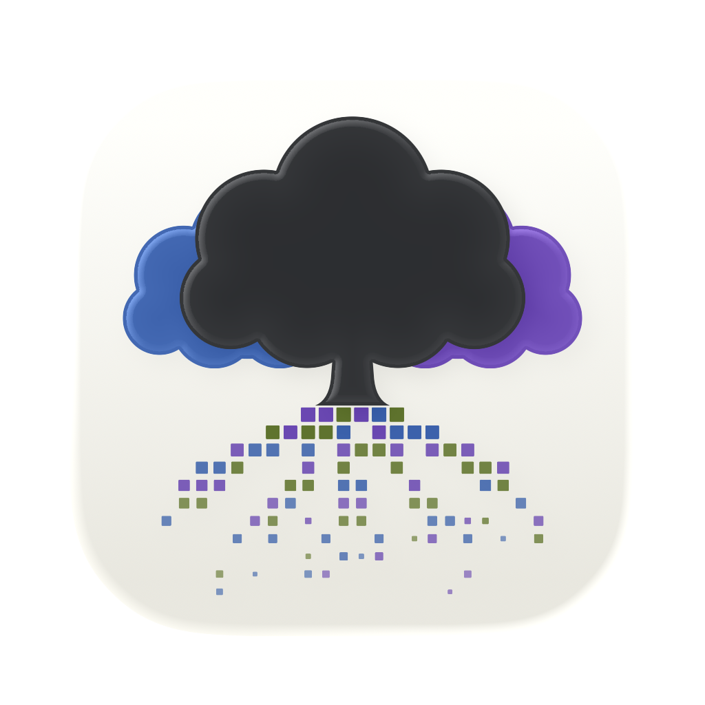
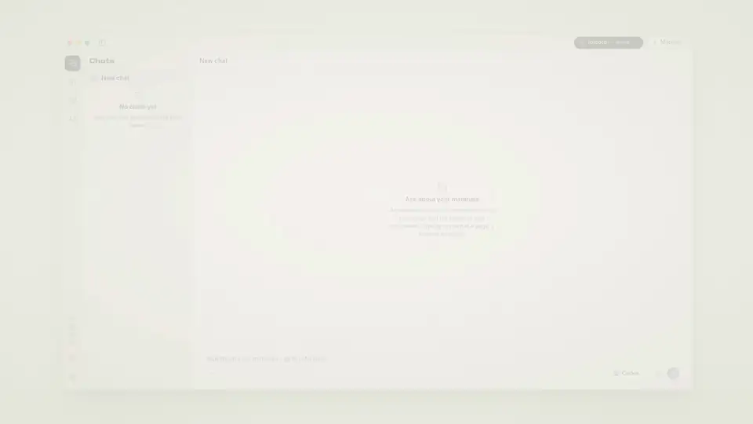
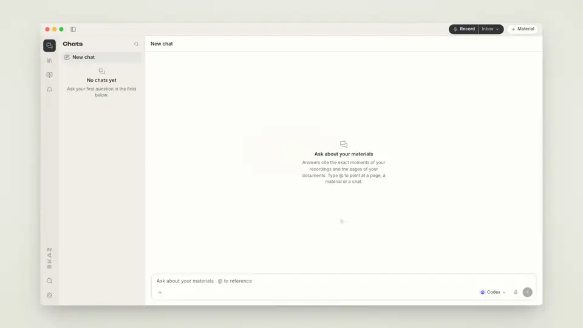
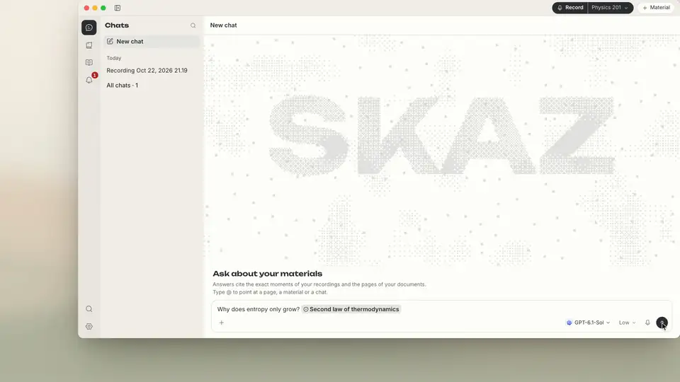
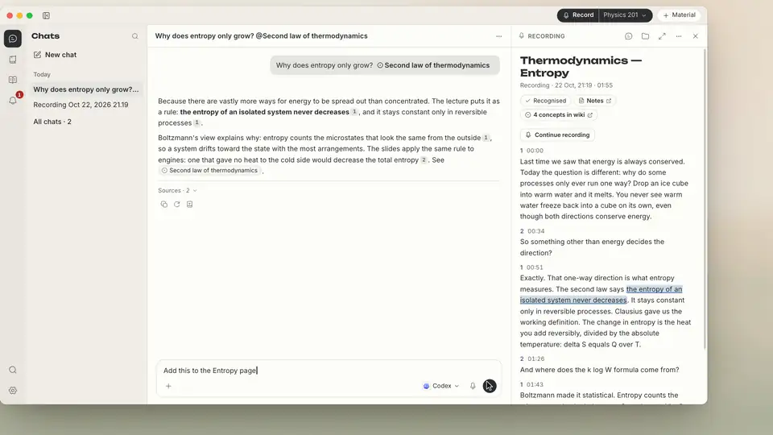
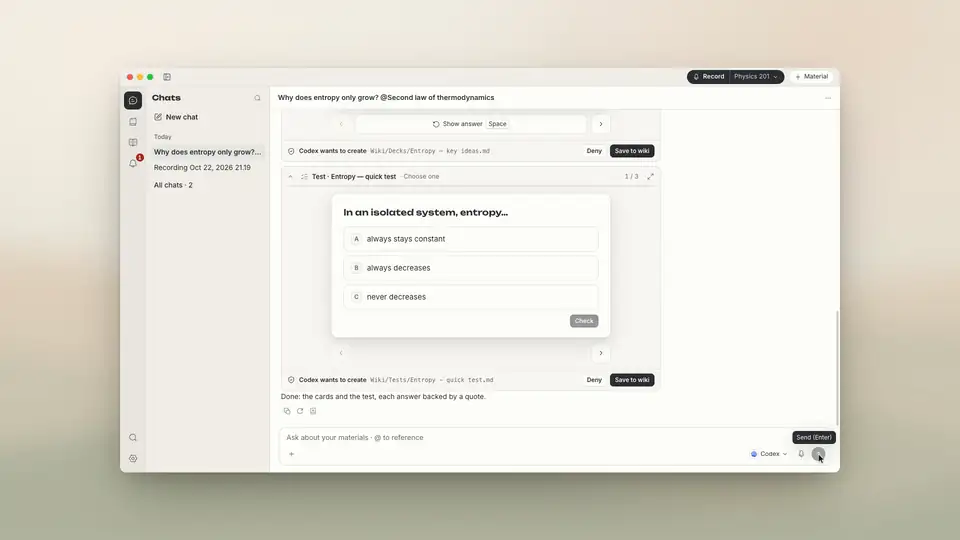
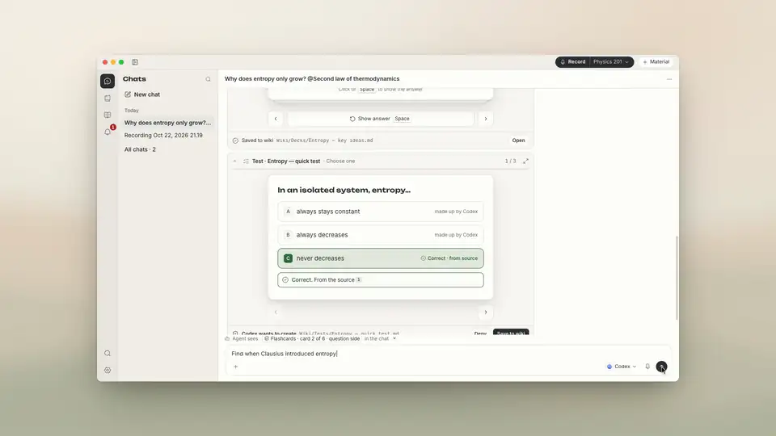
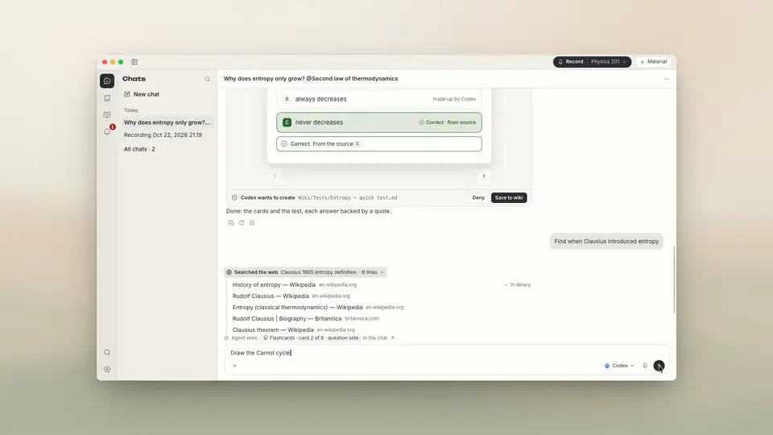
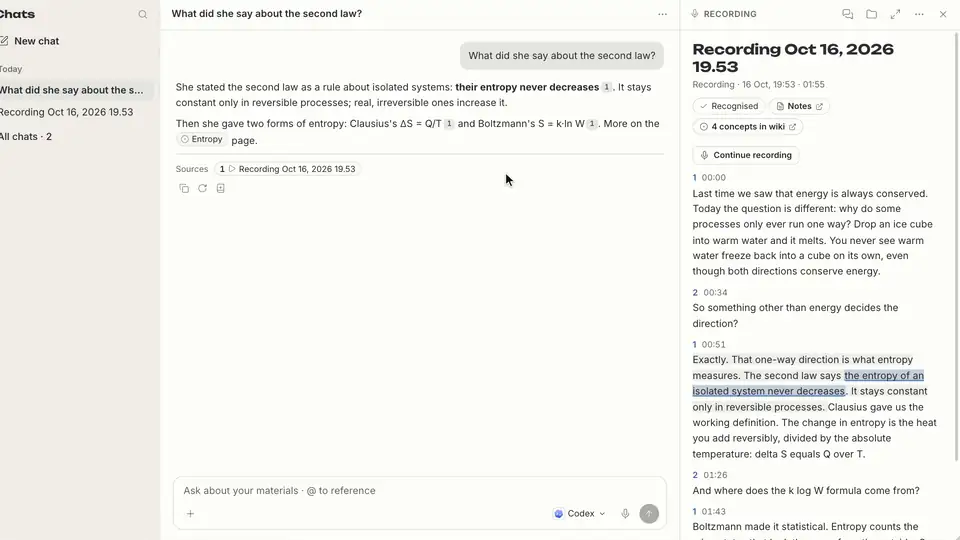
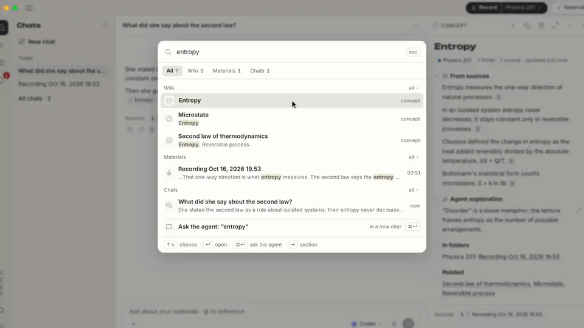

<div align="center">



# SKAZ

### Лекции, встречи и документы — в wiki, которую можно спросить

Запишите или добавьте источник · спросите и получите точные ссылки · wiki обновляется сама

[](https://github.com/all0b0y/SKAZ/releases/latest)


[](../../LICENSE)

[English](../../README.md) · **Русский** · [Español](README.es.md) · [Deutsch](README.de.md) · [简体中文](README.zh-CN.md)

<br>



<sub>Обзор продукта · демопрофиль с подготовленными данными · <a href="../images/skaz-tour.mp4">Весь обзор в Full HD (MP4, 80 с)</a></sub>

<br><br>

[**Установка**](#-установка) · [**Возможности**](#-возможности) · [**Приватность**](#-приватность-и-данные) · [**Как устроено**](#-как-устроено) · [**Участие**](../../CONTRIBUTING.md)

</div>

---

SKAZ — приложение для macOS для всего, что вы слушаете и читаете. Запишите лекцию или встречу
либо добавьте PDF, статью, ссылку на видео или файл. SKAZ хранит каждый источник в вашей папке
Markdown-файлов, собирает из них wiki и отвечает на вопросы со ссылками на точный момент или
страницу.

> [!WARNING]
> **Альфа-версия, ранний доступ.** Возможны ошибки и несовместимые изменения, в том числе в
> формате хранимых данных. Делайте резервные копии важных экспортов. SKAZ рассчитан на macOS на
> Apple Silicon; Windows, Linux и Mac на Intel не проверялись. Интерфейс пока только на английском.

## 💡 Зачем SKAZ

Лекция, встреча на прошлой неделе, прочитанная глава — всё это лежит в разных местах и никак не
связано. SKAZ держит их вместе. У каждого источника появляются конспект и страницы понятий в одной
wiki, поэтому одна и та же идея из лекции и из учебника оказывается на одной странице. Спросите
*«что она сказала про второе начало?»* — и по сноске вернитесь к той секунде, где это прозвучало.

ИИ может ошибаться. Ссылки на источники помогают проверить ответ, но не гарантируют, что он верен.

## 👀 Как это выглядит

<table>
<tr>
<td width="50%"><br><b>Запись в папку</b><br>Выберите папку, нажмите Record — транскрипция появляется по ходу речи, по говорящим и со временем.</td>
<td width="50%"><br><b>Ответы со ссылками</b><br>У каждого утверждения есть сноска. Откройте её — SKAZ перейдёт к цитате в источнике.</td>
</tr>
<tr>
<td width="50%"><br><b>Агент спрашивает сначала</b><br>Агент меняет wiki только через SKAZ, и вы видите правку до того, как она произойдёт: Allow или Deny.</td>
<td width="50%"><br><b>Карточки и тесты</b><br>Попросите карточки или тест по лекции. Каждый ответ подкреплён проверенной цитатой; карточки возвращаются по интервальному повторению.</td>
</tr>
<tr>
<td width="50%"><br><b>Поиск в интернете — с вашего разрешения</b><br>Вы видите точный запрос до отправки. Найденная страница попадает в библиотеку одним кликом.</td>
<td width="50%"><br><b>Схемы</b><br>Ответ может содержать схему, она рисуется на вашем Mac. Откройте её в полный размер и приблизьте.</td>
</tr>
<tr>
<td width="50%"><br><b>Wiki, которая пишется сама</b><br>Страницы понятий из всех ваших источников, связанные между собой, с пометками: что процитировано, а что — вывод агента.</td>
<td width="50%"><br><b>Светлая и тёмная</b><br>Как в системе или на выбор в <b>Settings → Appearance</b>.</td>
</tr>
</table>

<sub>Собрано из собственного интерфейса SKAZ 0.3.1 (его HTML и CSS) с помощью <a href="https://github.com/heygen-com/hyperframes">HyperFrames</a>.
Лекция, слайды, ответы, карточки и результаты поиска — подготовленные демонстрационные данные, а не результат
реального распознавания речи, работы ИИ или поиска.</sub>

## ✨ Возможности

| | |
|---|---|
| 🎙️ **Живая запись** | Микрофон и, по желанию, звук компьютера (Zoom, видео; нужны macOS 14.2+ и разрешение системы). Распознавание через **Soniox** (потоковое в облаке, разделение говорящих, перевод) или **Whisper на этом компьютере** (работает без интернета). SKAZ никогда не переключает сервис молча. |
| 📚 **Любые источники** | PDF, документы, текстовые и Markdown-файлы, аудио и видео, веб-статьи (в очищенном виде), вставленный текст любой длины и ссылки на видео с YouTube, VK Видео, RuTube и Vimeo. Используйте только материалы, которые вам разрешено обрабатывать. |
| 🧠 **Живая wiki** | Конспект для каждого источника, одна страница на понятие для всех папок и сохранённые разборы. Каждое утверждение помечено: цитата из источника, связь — вывод агента или пояснение агента. Если источники расходятся, показываются обе версии, а решаете вы. |
| 💬 **Чаты со сносками** | Спрашивайте обо всей библиотеке; агент знает, что сейчас открыто и идёт ли запись. Сноски открывают точный момент записи или страницу документа. Через **@** можно указать страницу, материал или чат. Ответы могут содержать схемы с просмотром в полный размер. |
| 🃏 **Карточки и тесты** | Попросите карточки или тест по странице, материалу или чату. Каждый правильный ответ подкреплён проверенной цитатой. Карточки повторяются по FSRS; колоды и тесты можно сохранить в wiki. |
| 🌐 **Поиск в интернете — с вашего разрешения** | Прежде чем что-то уйдёт с вашего Mac, вы видите точный запрос и выбираете Allow once, Allow in this chat или Deny. Отправляется только запрос. Найденную страницу можно добавить в библиотеку одним кликом. |
| 🤖 **Ваш агент** | **Codex**, **Claude Code**, **Hermes Agent** или **OpenCode** — с вашей подпиской или ключом; SKAZ может установить их сам. Агенты читают библиотеку через инструменты SKAZ и меняют страницы wiki только с вашего разрешения, с возможностью отмены (Undo); ваши собственные заметки не трогаются. Модель выбирается для каждого чата, избранные отмечаются звёздочкой. Мелкие решения о раскладке можно поручить локальной модели или OpenRouter. |
| ✍️ **Исправление распознавания** | Необязательная проверка находит вероятные ошибки распознавания, уверенные исправляет, а сомнительные только подсвечивает. Любое исправление можно отменить. |
| 🗂️ **Обычные файлы** | Библиотека — это папка `.md`-файлов. Откройте её в **Obsidian** или экспортируйте всё в обычный Markdown со ссылками на источники в сносках. Ваши правки страниц wiki защищены от агента. |
| 🔄 **Обновления** | SKAZ проверяет релизы на GitHub при запуске и раз в день и устанавливает проверенное обновление из **Settings → About**. |

## 📦 Установка

Вставьте в Терминал (Apple Silicon, macOS 13 или новее):

```bash
curl -fsSL https://raw.githubusercontent.com/all0b0y/SKAZ/main/install.sh | bash
```

[Скрипт](../../install.sh) скачивает последний релиз, проверяет контрольную сумму SHA-256 и подпись
SKAZ, устанавливает SKAZ в «Программы» и открывает его. Для обновления запустите ту же команду —
библиотека и настройки останутся на месте. SKAZ пока не нотаризован Apple; установленное так
приложение открывается без предупреждения «Не удалось проверить…».

<details>
<summary><b>Установка из DMG или PKG</b></summary>
<br>

Скачайте `SKAZ-<version>-arm64.dmg` (или установщик `.pkg`) со страницы
[GitHub Releases](https://github.com/all0b0y/SKAZ/releases/latest), откройте его и перетащите SKAZ
в «Программы». При первом запуске macOS сообщит, что не может проверить SKAZ: нажмите **Готово**,
а не «Переместить в Корзину». Затем откройте **Системные настройки → Конфиденциальность и
безопасность** и нажмите **Все равно открыть** рядом с сообщением о SKAZ. Это нужно один раз для
каждой скачанной сборки. Не отключайте защиту macOS целиком.

</details>

Хотите запустить текущий код? Смотрите [настройку разработки](../../CONTRIBUTING.md).

### 🚀 Первый запуск

1. **Агент.** Выберите Codex, Claude Code, Hermes Agent или OpenCode и войдите в свою учётную запись.
   SKAZ может установить агента сам. Действуют условия, лимиты и тарифы провайдера.
2. **Речь.** Добавьте ключ Soniox и разрешите отправку аудио в Soniox — или выберите **Whisper
   on this computer** и скачайте модель речи (размер показывается заранее; ключ не нужен).
3. **Библиотека.** Выберите, где она будет храниться; SKAZ предлагает папку в «Документах».
4. **Работа.** Нажмите **Record** (папка выбирается рядом с кнопкой) или **+ Material**, чтобы
   добавить файл, ссылку или текст. Спрашивайте в чате; откройте **Wiki**, чтобы прочитать, что
   собрал SKAZ.

Любой выбор можно поменять позже в **Settings**.

> [!IMPORTANT]
> Получите согласие, прежде чем записывать других людей. У Soniox, агентов и OpenRouter свои
> тарифы и правила; лицензия MIT их использование не покрывает.

## 🔒 Приватность и данные

| Что | Где хранится / куда уходит |
|---|---|
| Материалы и wiki | Обычные `.md`-файлы в выбранной вами папке библиотеки. |
| Индекс, чаты, настройки | Локальные файлы в собственной папке приложения SKAZ. |
| Живое аудио | Не хранится как архив для прослушивания. Временное аудио может использоваться для обработки или восстановления. |
| Распознавание речи | **Soniox:** аудио отправляется после вашего согласия, которое можно отозвать в любой момент. **Whisper на этом компьютере:** аудио не покидает ваш Mac. |
| Агент | Ваш вопрос и части библиотеки, которые он читает, уходят выбранному агенту; действуют его правила хранения и обучения. |
| Поиск в интернете | Только одобренный вами запрос — в поиск агента, указанного на карточке, без истории чата и текста библиотеки. Добавление найденной страницы — один запрос по её адресу. |
| Ключи | Зашифрованный локальный файл в папке приложения SKAZ, ключ шифрования лежит рядом. Основная защита — права доступа к файлам, а не защита от процессов, запущенных от вашего пользователя. |
| Журнал действий | Ведётся без текста разговоров и ключей. |
| Бэкенд | Python, только loopback, новый токен при каждом запуске. |

Текст ваших источников — это данные, а не инструкции: фрагмент, обращённый к ИИ, исключается из
wiki, SKAZ сообщает об этом и даёт вернуть его.
**Локальное хранение не означает офлайн-обработку.** Защищайте и экспорты, и резервные копии.
Ограничения и канал для сообщений — в [политике безопасности](../../SECURITY.md).

## 🧩 Как устроено

```text
Микрофон / звук системы / файлы / ссылки → Electron → Python ── Soniox | Whisper на этом Mac
                                             ↓          ↓
                                         React UI   Библиотека: Materials/*.md, Wiki/*.md
                                                        ↕  инструменты SKAZ (изменения — только с вашего разрешения)
                                             Codex | Claude Code | Hermes Agent | OpenCode
```

| Слой | Технологии |
|---|---|
| Десктоп | Electron |
| Интерфейс | React, TypeScript, CodeMirror |
| Локальный бэкенд | Python, FastAPI, индекс SQLite поверх Markdown-файлов |

## 🗺️ Что дальше

- [ ] Нотаризация релизов в Apple
- [ ] Иллюстрированные ответы и конспекты по PDF-презентациям
- [ ] Более широкая проверка в реальных условиях

## 🤝 Участие

В [Contributing](../../CONTRIBUTING.md) — настройка, тесты и pull request'ы; в
[Packaging](../PACKAGING.md) — сборка установщиков. Небольшие исправления можно сразу присылать PR,
крупные изменения сначала обсудите в issue. Описания релизов — в
[GitHub Releases](https://github.com/all0b0y/SKAZ/releases).

[Правила сообщества](../../CODE_OF_CONDUCT.md) · [Политика безопасности](../../SECURITY.md) · [Лицензия MIT](../../LICENSE)

---

<div align="center">
<sub><i>Сказ</i> — устный рассказ. Прежнее название — AudioHelper.<br>
Copyright © 2026 all0b0y.</sub>
</div>
