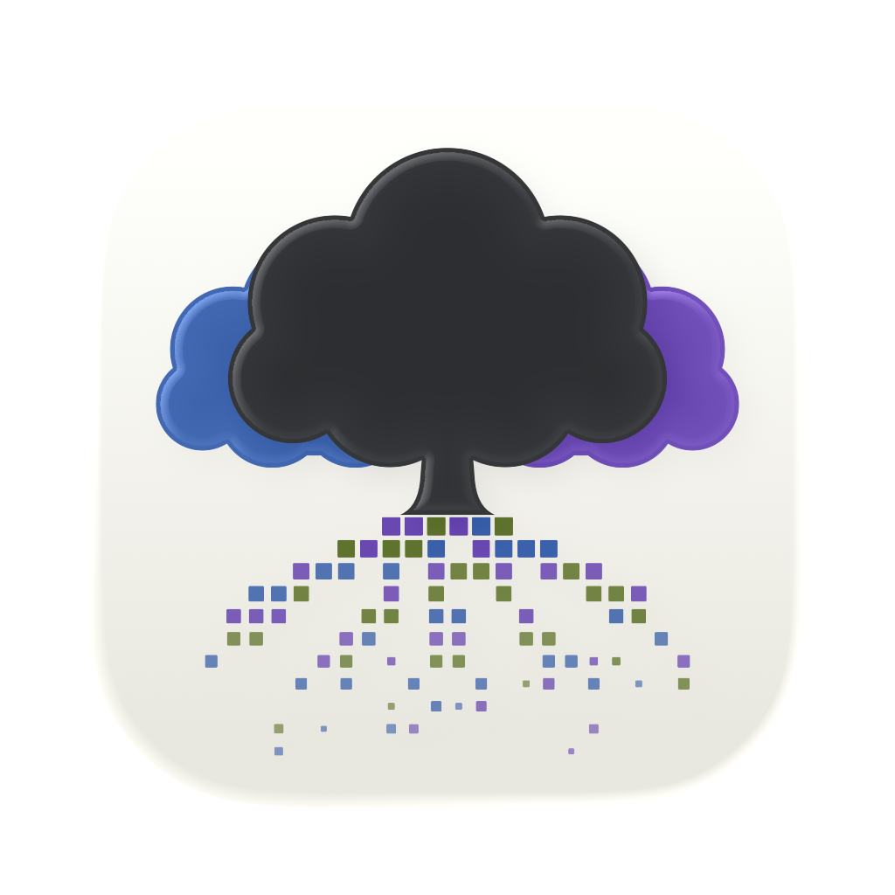
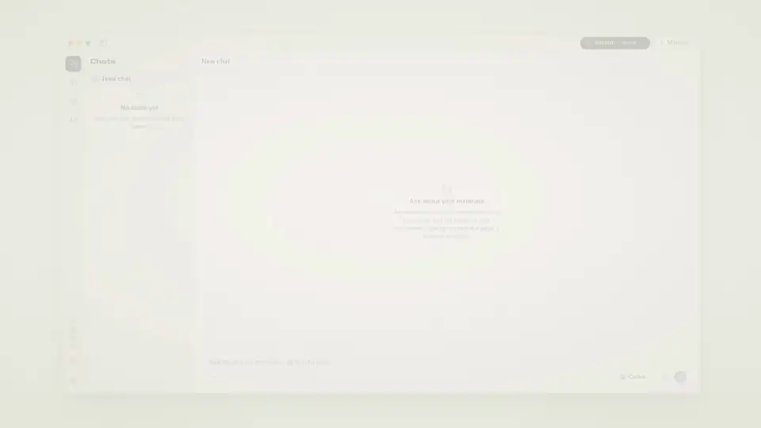
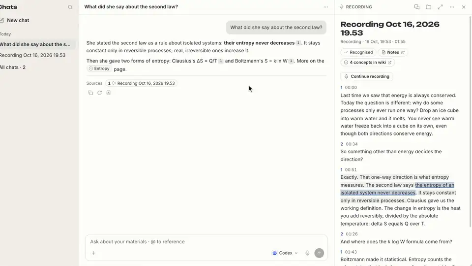
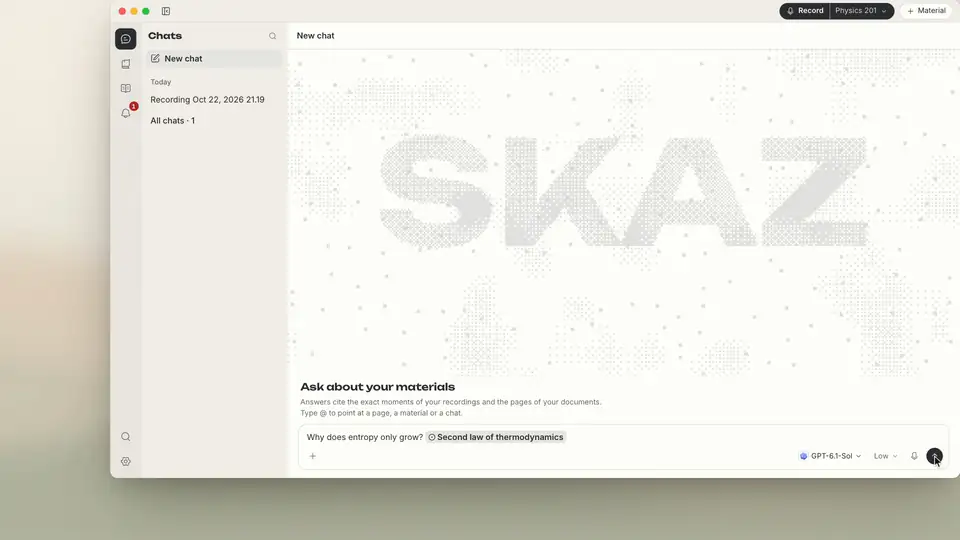
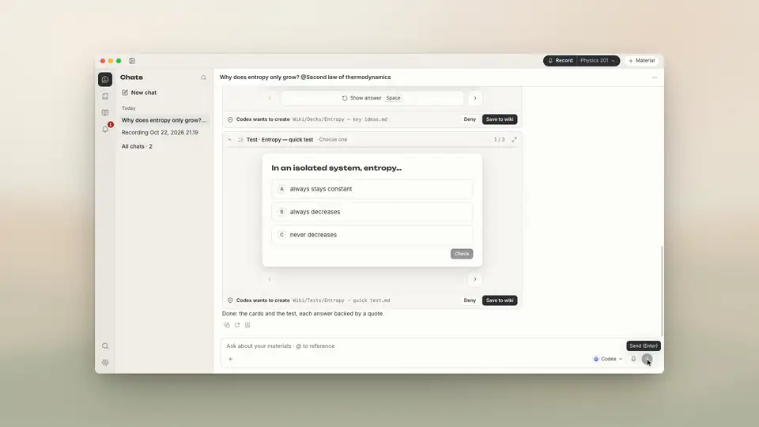
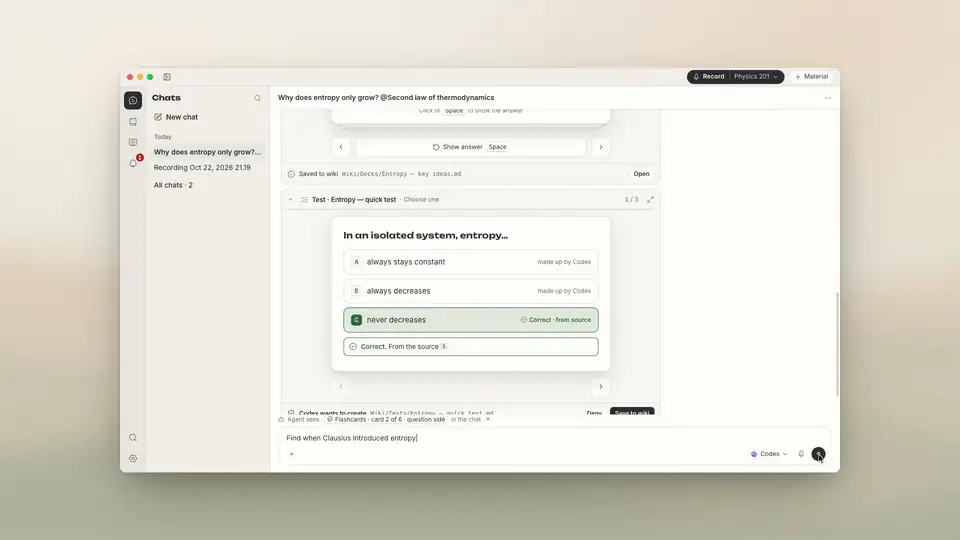
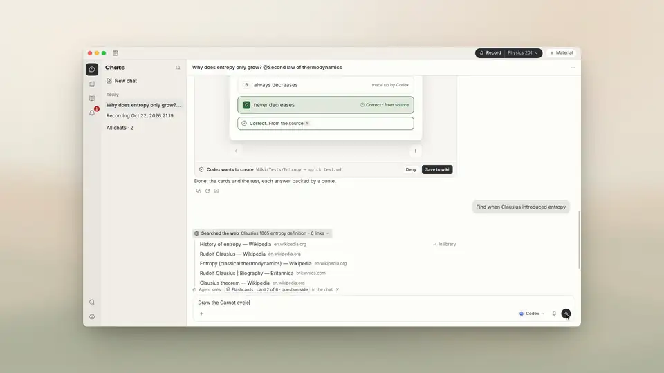
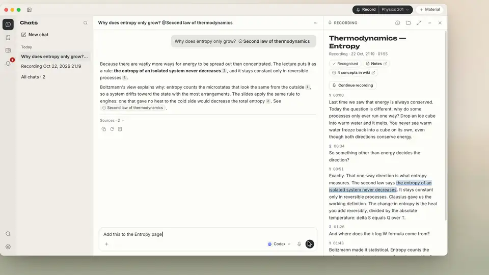
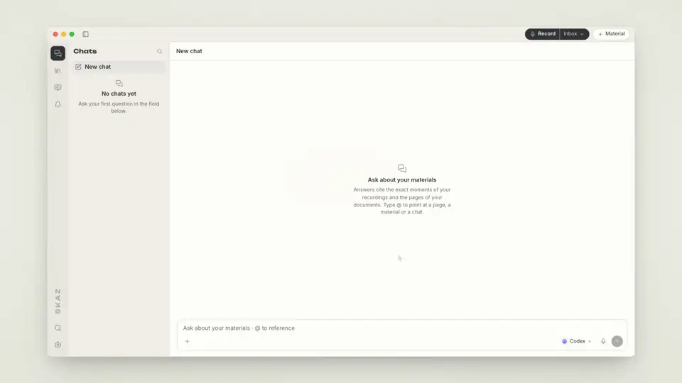
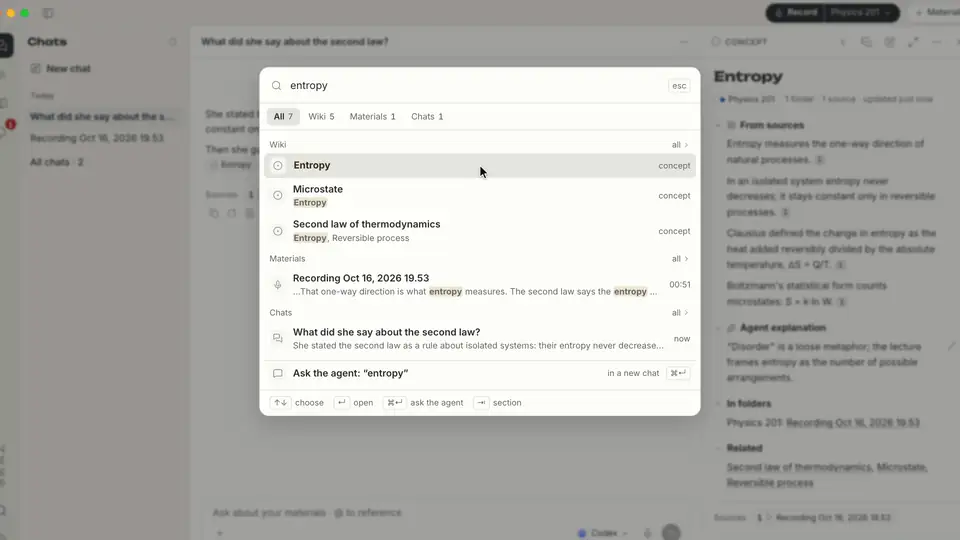

<div align="center">



# SKAZ

### Превращайте информацию в знания — и развивайте их

Собирайте и связывайте · разбирайтесь и учитесь · повторяйте и расширяйте знания

[](https://github.com/all0b0y/SKAZ/releases/latest)


[](../../LICENSE)

[English](../../README.md) · **Русский** · [Español](README.es.md) · [Deutsch](README.de.md) · [简体中文](README.zh-CN.md)

<br>



<sub>Обзор продукта · демопрофиль с подготовленными данными · <a href="../images/skaz-tour.mp4">Весь обзор в Full HD (MP4, 80 с)</a></sub>

<br><br>

[**Установка**](#-установка) · [**Сценарий работы**](#-от-информации-к-знаниям) · [**Возможности**](#-возможности) · [**Приватность**](#-приватность-и-данные) · [**Как устроено**](#-как-устроено) · [**Участие**](../../CONTRIBUTING.md)

</div>

---

SKAZ — приложение для macOS, которое помогает организовывать информацию, разбираться в ней
и возвращаться к изученному. Собирайте файлы, статьи, заметки, видео и устную речь в связанную
базу знаний. Задавайте вопросы со ссылками на источники, учитесь с помощью карточек и тестов,
освежайте изученное и дополняйте свои знания новыми источниками.

Материалы и wiki хранятся обычными Markdown-файлами в выбранной вами папке.

> [!WARNING]
> **Альфа-версия, ранний доступ.** Возможны ошибки и несовместимые изменения, в том числе в
> формате хранимых данных. Делайте резервные копии важных экспортов. SKAZ рассчитан на macOS на
> Apple Silicon; Windows, Linux и Mac на Intel не проверялись. Интерфейс пока только на английском.

## 💡 Зачем SKAZ

Сохранить информацию — ещё не значит понять, запомнить и суметь ею воспользоваться. Полезное
объяснение теряется в чате, заметки теряют контекст, а к теме, в которой вы когда-то разобрались,
со временем становится трудно вернуться.

SKAZ объединяет источники, связанную wiki, вопросы и обучение. Прослеживайте одну идею в разных
материалах, разбирайте объяснения, проверяйте понимание и возвращайтесь к первоисточнику, чтобы
освежить изученное. Новые материалы дополняют уже собранные знания, поэтому не приходится
каждый раз начинать с нуля.

ИИ может ошибаться. Ссылки на источники помогают проверить ответ, но не гарантируют, что он верен.

## 🧭 От информации к знаниям

### 1. Собирайте

Начните с PDF, статьи, собственного текста, видео или аудиофайла. Устную речь можно записывать
в реальном времени. Это разные способы пополнить одну библиотеку, а не отдельные сценарии.

### 2. Организуйте и разбирайтесь

Превращайте материалы в конспекты и связанные страницы понятий. Просите объяснить сложное,
сопоставляйте идеи и переходите по ссылкам к фрагменту, странице или таймкоду. Утверждения
из источников, предполагаемые связи и пояснения агента помечаются отдельно.

### 3. Учитесь и повторяйте

Попросите карточки или тест по материалу, странице wiki или чату. Сохраните колоды и тесты
в wiki, повторяйте сохранённые карточки по алгоритму FSRS и возвращайтесь к сложным темам.
Цель — сохранять полезные знания доступными, а не оставлять их в документе, к которому вы
больше не вернётесь.

### 4. Расширяйте знания

Ищите дополнительные источники через веб-поиск с вашего разрешения. Выбирайте, какие результаты
добавить в библиотеку, связывайте их с имеющимися материалами и продолжайте разбираться в теме.
Результаты веб-поиска не смешиваются со ссылками на вашу библиотеку.

## 👀 Как это выглядит

<table>
<tr>
<td width="50%"><br><b>Связывайте знания</b><br>Конспекты и страницы понятий объединяют близкие идеи. Видно, что взято из источника, а что является выводом агента.</td>
<td width="50%"><br><b>Разбирайтесь в вопросах</b><br>Задавайте вопросы по материалам, читайте объяснения и открывайте ссылки на источники, чтобы проверить контекст.</td>
</tr>
<tr>
<td width="50%"><br><b>Освежайте изученное</b><br>Создавайте карточки или тесты по своим материалам. Сохраните колоду и возвращайтесь к ней для интервального повторения.</td>
<td width="50%"><br><b>Находите другой взгляд</b><br>Разрешите поисковый запрос, изучите результаты и выберите, какие источники добавить в библиотеку.</td>
</tr>
<tr>
<td width="50%"><br><b>Рассматривайте связи</b><br>Ответы могут содержать схемы, которые рисуются на вашем Mac. Открывайте их в полном размере, чтобы разобрать детали.</td>
<td width="50%"><br><b>Сохраняйте контроль</b><br>Проверяйте предложенные агентом правки wiki до их применения. Ваши собственные заметки остаются вашими.</td>
</tr>
<tr>
<td width="50%"><br><b>Запись в папку</b><br>Выберите папку, нажмите Record — транскрипция появляется по ходу речи, по говорящим и со временем.</td>
<td width="50%"><br><b>Светлая и тёмная</b><br>Как в системе или на выбор в <b>Settings → Appearance</b>.</td>
</tr>
</table>

<sub>Собрано из собственного интерфейса SKAZ 0.3.1 (его HTML и CSS) с помощью <a href="https://github.com/heygen-com/hyperframes">HyperFrames</a>.
Лекция, слайды, ответы, карточки и результаты поиска — подготовленные демонстрационные данные, а не результат
реального распознавания речи, работы ИИ или поиска.</sub>

## ✨ Возможности

| | |
|---|---|
| 📚 **Разные источники в одной библиотеке** | PDF, текстовые и Markdown-файлы, вставленный текст, веб-статьи, аудио и видео, а также ссылки на видео с YouTube, VK Видео, RuTube и Vimeo. Используйте только материалы, которые вам разрешено обрабатывать. |
| 🧠 **Связанная база знаний** | Конспекты источников, общие страницы понятий для разных папок и сохранённые разборы образуют одну wiki. Утверждения из источников, предполагаемые связи и пояснения агента помечены отдельно. Если источники расходятся, показываются обе версии, а решаете вы. |
| 💬 **Понимание с опорой на источники** | Спрашивайте обо всей библиотеке, сопоставляйте идеи и возвращайтесь к объяснениям. Ссылки открывают нужный фрагмент, страницу документа или таймкод. Через **@** можно указать страницу, материал или чат. Ответы могут содержать схемы с просмотром в полном размере. |
| 🃏 **Обучение и повторение** | Создавайте карточки и тесты по странице, материалу или чату; правильные ответы подкрепляются проверенными цитатами из источников. Сохраняйте колоды и тесты в wiki: для сохранённых карточек работает **интервальное повторение FSRS**. Повторяйте карточки по расписанию, отдельно тренируйте сложные или возвращайтесь к теме целиком. |
| 🌐 **Новые знания за пределами библиотеки** | Ищите дополнительные источники из чата. Вы видите точный запрос и выбираете Allow once, Allow in this chat или Deny; в поиск отправляется только запрос. Изучите результаты и добавьте выбранную страницу в библиотеку одним кликом. |
| 🗂️ **Доступ к своим знаниям** | Материалы и wiki — это папка `.md`-файлов. Откройте её в **Obsidian** или экспортируйте в обычный Markdown со сносками на источники. Ваши правки страниц wiki защищены от агента. |
| 🎙️ **Живая запись** | Микрофон и, по желанию, звук компьютера (Zoom, видео; нужны macOS 14.2+ и разрешение системы). Распознавание через **Soniox** (потоковое в облаке, разделение говорящих, перевод) или **Whisper на этом компьютере** (работает без интернета). SKAZ никогда не переключает сервис молча. |
| 🤖 **Ваш агент** | **Codex**, **Claude Code**, **Hermes Agent** или **OpenCode** — с вашей подпиской или ключом; SKAZ может установить их сам. Агенты читают библиотеку через инструменты SKAZ и меняют страницы wiki только с вашего разрешения, с возможностью отмены (Undo); ваши собственные заметки не трогаются. Модель выбирается для каждого чата, избранные отмечаются звёздочкой. Мелкие решения о раскладке можно поручить локальной модели или OpenRouter. |
| ✍️ **Исправление распознавания** | Необязательная проверка находит вероятные ошибки распознавания, уверенные исправляет, а сомнительные только подсвечивает. Любое исправление можно отменить. |
| 🔄 **Обновления** | SKAZ проверяет релизы на GitHub при запуске и раз в день и устанавливает проверенное обновление из **Settings → About**. |

## 📦 Установка

Вставьте в Терминал (Apple Silicon, macOS 13 или новее):

```bash
curl -fsSL https://raw.githubusercontent.com/all0b0y/SKAZ/main/install.sh | bash
```

[Скрипт](../../install.sh) скачивает последний релиз, проверяет контрольную сумму SHA-256 и подпись
SKAZ, устанавливает SKAZ в «Программы» и открывает его. Для обновления запустите ту же команду —
библиотека и настройки останутся на месте. SKAZ пока не нотаризован Apple; установленное так
приложение открывается без предупреждения «Не удалось проверить…».

<details>
<summary><b>Установка из DMG или PKG</b></summary>
<br>

Скачайте `SKAZ-<version>-arm64.dmg` (или установщик `.pkg`) со страницы
[GitHub Releases](https://github.com/all0b0y/SKAZ/releases/latest), откройте его и перетащите SKAZ
в «Программы». При первом запуске macOS сообщит, что не может проверить SKAZ: нажмите **Готово**,
а не «Переместить в Корзину». Затем откройте **Системные настройки → Конфиденциальность и
безопасность** и нажмите **Все равно открыть** рядом с сообщением о SKAZ. Это нужно один раз для
каждой скачанной сборки. Не отключайте защиту macOS целиком.

</details>

Хотите запустить текущий код? Смотрите [настройку разработки](../../CONTRIBUTING.md).

### 🚀 Первый запуск

1. **Агент.** Выберите Codex, Claude Code, Hermes Agent или OpenCode и войдите в свою учётную запись.
   SKAZ может установить агента сам. Действуют условия, лимиты и тарифы провайдера.
2. **Речь (по желанию).** Для работы с аудио добавьте ключ Soniox и разрешите отправку аудио
   в Soniox — или выберите **Whisper on this computer** и скачайте модель речи (размер показан
   заранее; ключ не нужен). Для текстовых материалов распознавание речи не требуется.
3. **Библиотека.** Выберите, где она будет храниться; SKAZ предлагает папку в «Документах».
4. **Начните с материала.** Через **+ Material** добавьте файл, ссылку или текст. Задавайте вопросы
   в чате и открывайте **Wiki**, чтобы изучить конспекты и понятия. Для записи устной речи нажмите
   **Record**; папка выбирается рядом с кнопкой.
5. **Возвращайтесь к изученному.** Попросите карточки или тест, сохраните их в wiki и вернитесь
   для повторения или более подробного разбора.

Любой выбор можно поменять позже в **Settings**.

> [!IMPORTANT]
> Получите согласие, прежде чем записывать других людей. У Soniox, агентов и OpenRouter свои
> тарифы и правила; лицензия MIT их использование не покрывает.

## 🔒 Приватность и данные

| Что | Где хранится / куда уходит |
|---|---|
| Материалы и wiki | Обычные `.md`-файлы в выбранной вами папке библиотеки. |
| Индекс, чаты, настройки | Локальные файлы в собственной папке приложения SKAZ. |
| Живое аудио | Не хранится как архив для прослушивания. Временное аудио может использоваться для обработки или восстановления. |
| Распознавание речи | **Soniox:** аудио отправляется после вашего согласия, которое можно отозвать в любой момент. **Whisper на этом компьютере:** аудио не покидает ваш Mac. |
| Агент | Ваш вопрос и части библиотеки, которые он читает, уходят выбранному агенту; действуют его правила хранения и обучения. |
| Поиск в интернете | Только одобренный вами запрос — в поиск агента, указанного на карточке, без истории чата и текста библиотеки. Добавление найденной страницы — один запрос по её адресу. |
| Ключи | Зашифрованный локальный файл в папке приложения SKAZ, ключ шифрования лежит рядом. Основная защита — права доступа к файлам, а не защита от процессов, запущенных от вашего пользователя. |
| Журнал действий | Ведётся без текста разговоров и ключей. |
| Бэкенд | Python, только loopback, новый токен при каждом запуске. |

Текст ваших источников — это данные, а не инструкции: фрагмент, обращённый к ИИ, исключается из
wiki, SKAZ сообщает об этом и даёт вернуть его.
**Локальное хранение не означает офлайн-обработку.** Защищайте и экспорты, и резервные копии.
Ограничения и канал для сообщений — в [политике безопасности](../../SECURITY.md).

## 🧩 Как устроено

Распознавание речи — один из способов ввода. Материалы, wiki, ответы и обучение используют общую библиотеку.

```text
Файлы / текст / ссылки / речь → Electron + React ↔ Python
                                                    ├─ Soniox | локальный Whisper (только речь)
                                                    ├─ Materials/*.md + Wiki/*.md
                                                    └─ инструменты SKAZ ↔ выбранный агент
                                                                              ↓
                                                           Ответы · связи · карточки · тесты
```

| Слой | Технологии |
|---|---|
| Десктоп | Electron |
| Интерфейс | React, TypeScript, CodeMirror |
| Локальный бэкенд | Python, FastAPI, индекс SQLite поверх Markdown-файлов |

## 🗺️ Что дальше

- [ ] Нотаризация релизов в Apple
- [ ] Иллюстрированные ответы и конспекты по PDF-презентациям
- [ ] Более широкая проверка в реальных условиях

## 🤝 Участие

В [Contributing](../../CONTRIBUTING.md) — настройка, тесты и pull request'ы; в
[Packaging](../PACKAGING.md) — сборка установщиков. Небольшие исправления можно сразу присылать PR,
крупные изменения сначала обсудите в issue. Описания релизов — в
[GitHub Releases](https://github.com/all0b0y/SKAZ/releases).

[Правила сообщества](../../CODE_OF_CONDUCT.md) · [Политика безопасности](../../SECURITY.md) · [Лицензия MIT](../../LICENSE)

---

<div align="center">
<sub><i>Сказ</i> — устный рассказ. Прежнее название — AudioHelper.<br>
Copyright © 2026 all0b0y.</sub>
</div>
