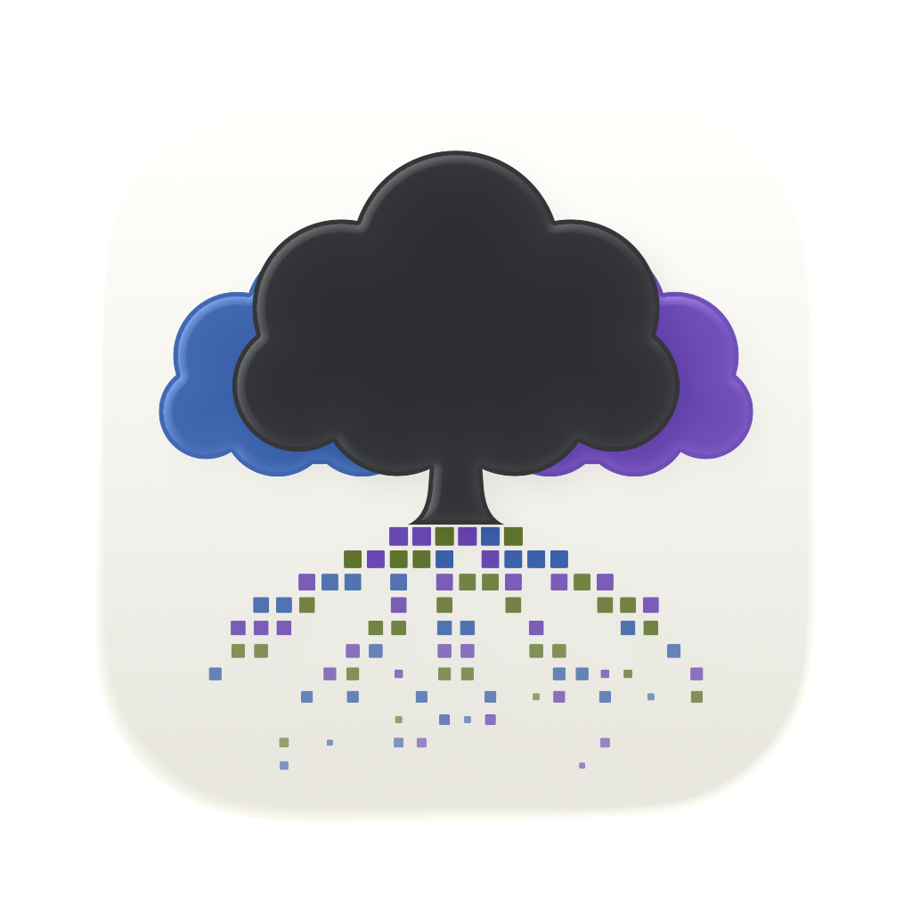
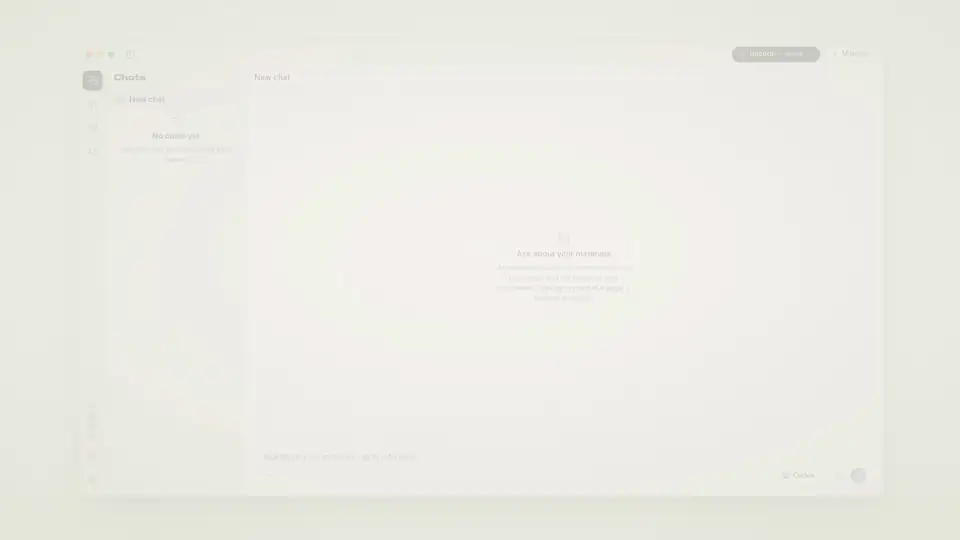
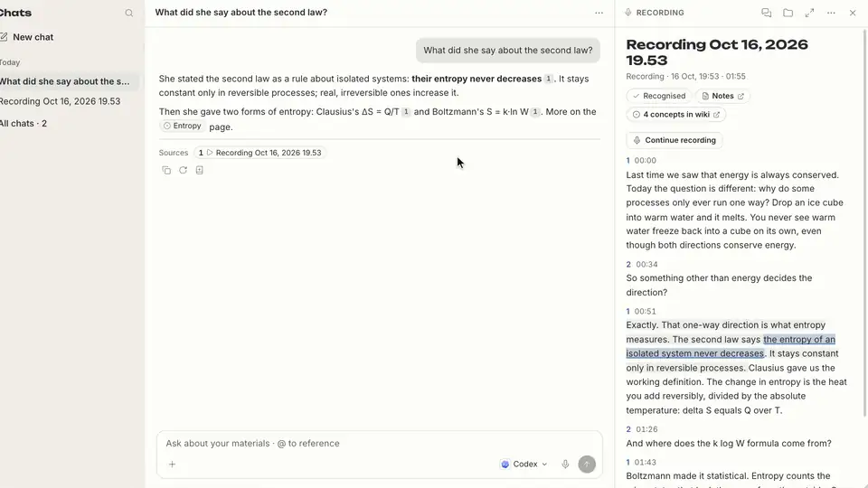
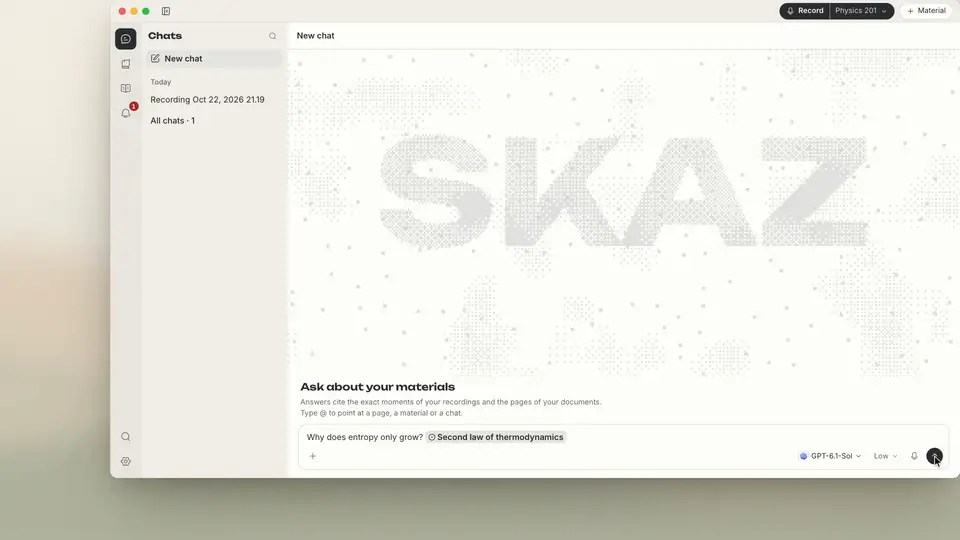
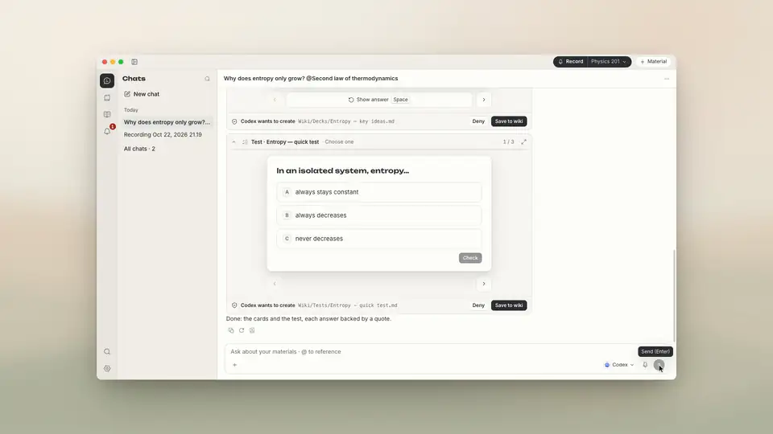
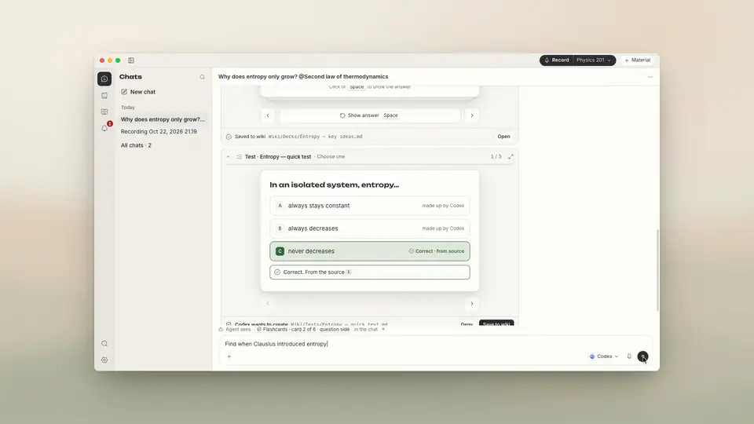
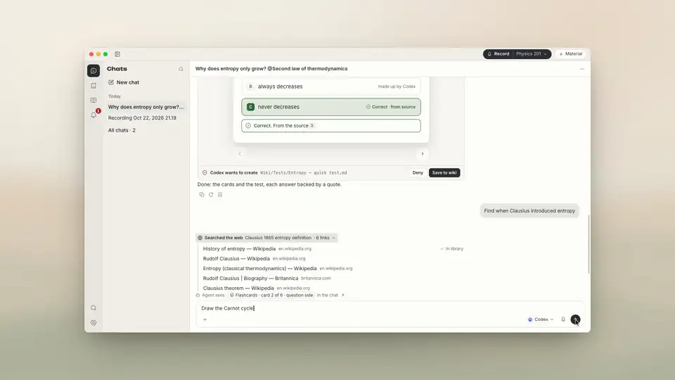
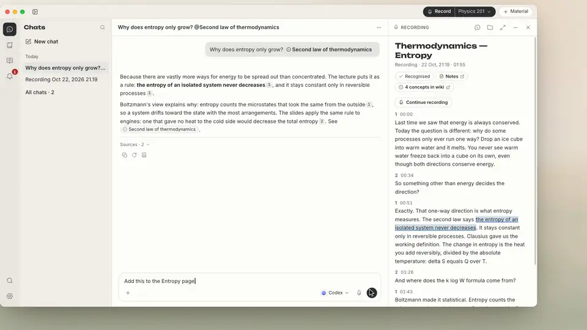
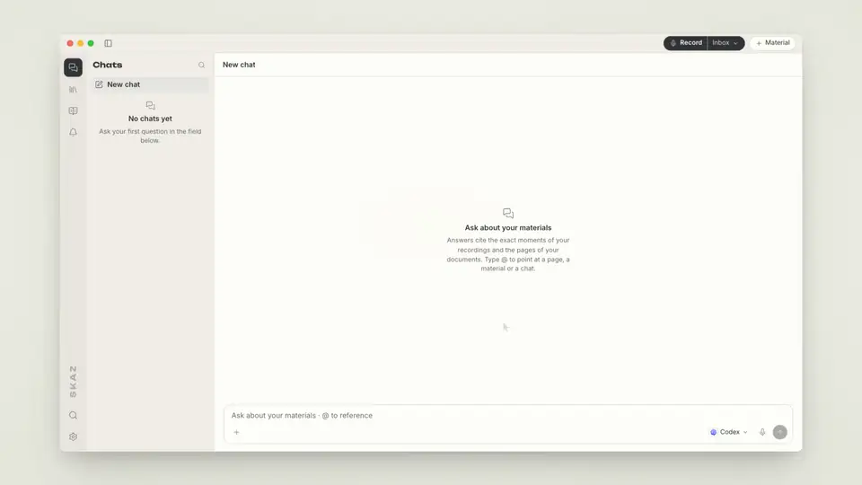
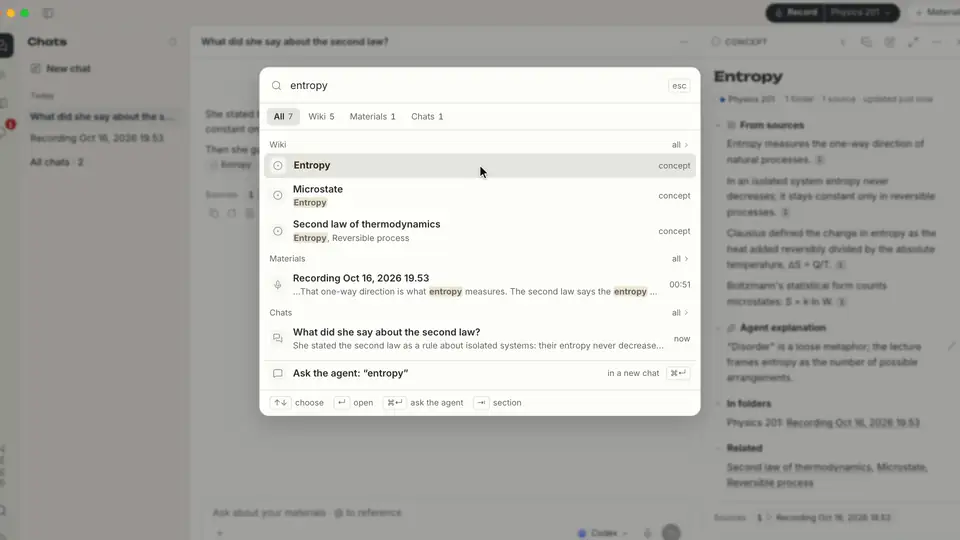

<div align="center">



# SKAZ

### 让零散信息成为可以积累、温习和拓展的知识

收集与关联 · 理解与学习 · 复习与探索

[](https://github.com/all0b0y/SKAZ/releases/latest)


[](../../LICENSE)

[English](../../README.md) · [Русский](README.ru.md) · [Español](README.es.md) · [Deutsch](README.de.md) · **简体中文**

<br>



<sub>产品导览 · 使用预先编写数据的演示配置 · <a href="../images/skaz-tour.mp4">完整导览，全高清（MP4，80 秒）</a></sub>

<br><br>

[**安装**](#-安装) · [**使用流程**](#-从信息到知识) · [**功能**](#-功能) · [**隐私**](#-隐私与数据) · [**工作原理**](#-工作原理) · [**参与贡献**](../../CONTRIBUTING.md)

</div>

---

SKAZ 是一款 macOS 应用，帮助你整理信息、理解内容，并随时回顾学过的知识。将文件、文章、笔记、视频
或口述内容汇入相互关联的知识库。提问时获取来源引用，用卡片和测验学习，复习已经学过的内容，
再通过新的来源拓展理解。

资料和 wiki 都以普通 Markdown 文件保存在你选择的文件夹中。

> [!WARNING]
> **Alpha / 抢先体验。** 可能存在错误和不兼容的变更，包括已存数据的变更。请备份重要的导出内容。
> SKAZ 面向 Apple Silicon 上的 macOS；Windows、Linux 和 Intel Mac 未经验证。目前界面仅提供英文。

## 💡 为什么选择 SKAZ

保存信息不等于理解、记住并能够运用。一段有用的解释可能埋在聊天记录里，笔记可能失去上下文，
曾经理解的主题也会变得难以重新拾起。

SKAZ 将来源资料、相互关联的 wiki、问答与学习放在一起。你可以在不同资料中追踪同一个想法，
逐步理解解释，检验自己的掌握程度，并回到原始来源温习。新的视角可以接在已有知识上，
而不必每次从头开始。

AI 可能出错。引用能帮你核实答案，但不能保证答案正确。

## 🧭 从信息到知识

### 1. 收集资料

从 PDF、文章、自己的文字、视频或音频文件开始，也可以实时记录口述内容。
这些都是进入同一个资料库的不同入口，而不是彼此割裂的流程。

### 2. 整理与理解

将资料整理成来源笔记和相互关联的概念页面。请智能体解释难点、比较观点，并通过引用回到原文段落、
页码或时间点。基于来源的陈述、智能体推断的关联，以及智能体的解释，都会分别标注。

### 3. 学习与复习

根据资料、wiki 页面或聊天生成卡片或测验。将卡组和测验保存到 wiki，使用 FSRS 间隔重复复习已保存的
卡片，并回顾较难的主题。目的是让有用的知识随时可用，而不是留在一份再也不会打开的文档里。

### 4. 拓展知识

通过你批准的网络搜索寻找更多来源。选择要加入资料库的结果，将它们与已有资料联系起来，继续探索。
网络搜索结果与个人资料库的引用分开呈现。

## 👀 实际效果

<table>
<tr>
<td width="50%"><br><b>关联已有知识</b><br>来源笔记和概念页面将相关想法联系起来，并标明哪些内容来自来源、哪些是智能体的推断。</td>
<td width="50%"><br><b>逐步解答疑问</b><br>就资料提问，阅读解释，并打开来源引用核实上下文。</td>
</tr>
<tr>
<td width="50%"><br><b>温习学过的内容</b><br>根据资料生成卡片或测验。保存卡组，再通过间隔重复持续复习。</td>
<td width="50%"><br><b>寻找另一种视角</b><br>批准搜索词，查看结果，再决定将哪些来源加入资料库。</td>
</tr>
<tr>
<td width="50%"><br><b>看清内容之间的关系</b><br>回答可以包含在你的 Mac 上渲染的图表。全尺寸打开，查看其中的细节。</td>
<td width="50%"><br><b>修改由你掌控</b><br>在允许修改前，先检查智能体提出的 wiki 编辑。你自己的笔记仍由你掌握。</td>
</tr>
<tr>
<td width="50%"><br><b>录进文件夹</b><br>选好文件夹，按下 Record，转写随讲话实时出现，按说话人和时间排列。</td>
<td width="50%"><br><b>浅色与深色</b><br>跟随系统，或在 <b>Settings → Appearance</b> 中选择主题。</td>
</tr>
</table>

<sub>使用 <a href="https://github.com/heygen-com/hyperframes">HyperFrames</a> 由 SKAZ 0.3.1 自身的界面（其 HTML 和 CSS）制作。
课程、幻灯片、回答、卡片和网络结果均为预先编写的演示数据，并非真实的语音识别、AI 输出或搜索。</sub>

## ✨ 功能

| | |
|---|---|
| 📚 **汇集不同来源** | PDF、文本和 Markdown 文件、粘贴文本、网页文章、音频和视频文件，以及 YouTube、VK Video、RuTube 和 Vimeo 的视频链接。请仅使用你有权处理的资料。 |
| 🧠 **相互关联的知识库** | 来源笔记、跨文件夹共用的概念页面和已保存的分析组成同一个 wiki。基于来源的陈述、推断出的关联和智能体的解释分别标注。来源有矛盾时，两种说法都会列出，由你判断。 |
| 💬 **依据来源理解内容** | 就整个资料库提问、比较观点，或重新阅读解释。引用会打开对应段落、文档页码或时间点。用 **@** 指向页面、资料或聊天。回答可以包含图表，并可全尺寸查看。 |
| 🃏 **学习与复习** | 根据页面、资料或聊天生成卡片和测验，正确答案有经过核对的来源引文支持。将卡组和测验保存到 wiki；已保存的卡片使用 **FSRS 间隔重复**。复习到期内容、练习较难的卡片，或重新学习某个主题。 |
| 🌐 **探索资料库之外的知识** | 在聊天中搜索更多来源。你会看到确切的搜索词，并选择 Allow once、Allow in this chat 或 Deny；只将搜索词发送给搜索服务。查看结果后，可一键将选定页面加入资料库。 |
| 🗂️ **随时访问自己的知识** | 资料和 wiki 存放在一个包含 `.md` 文件的文件夹里。可用 **Obsidian** 打开，也可导出为带来源脚注的普通 Markdown。你对 wiki 页面的修改受到保护，智能体不会覆盖。 |
| 🎙️ **实时录制** | 麦克风，也可同时录制 Mac 的声音（Zoom、视频；需要 macOS 14.2+ 和系统授权）。识别可选 **Soniox**（云端流式、说话人分离、翻译）或 **本机 Whisper**（离线可用）。SKAZ 从不悄悄切换服务。 |
| 🤖 **你的智能体** | **Codex**、**Claude Code**、**Hermes Agent** 或 **OpenCode**，使用你自己的订阅或密钥；SKAZ 可以替你安装。智能体通过 SKAZ 工具读取资料库，只有在你允许后才会修改 wiki 页面，并可撤销（Undo）；你自己的笔记不会被改动。每个聊天可以单独选择模型，常用模型可加星标收藏。归档之类的小决定可以交给本地模型或 OpenRouter。 |
| ✍️ **识别纠错** | 可选的检查会找出可能的识别错误，修正有把握的部分，只高亮存疑之处。每处修正都可撤销。 |
| 🔄 **更新** | SKAZ 在启动时和每天一次检查 GitHub 发布，并可在 **Settings → About** 中安装经过校验的更新。 |

## 📦 安装

把下面这行粘贴到终端（Apple Silicon，macOS 13 或更高版本）：

```bash
curl -fsSL https://raw.githubusercontent.com/all0b0y/SKAZ/main/install.sh | bash
```

该[脚本](../../install.sh)会下载最新版本，校验 SHA-256 校验和与 SKAZ 的签名，把 SKAZ 安装到“应用程序”
并打开它。更新时再运行同一条命令即可——资料库和设置都会保留。SKAZ 尚未经过 Apple 公证；通过这种方式
安装的应用打开时不会出现“Apple 无法验证……”的警告。

<details>
<summary><b>改用 DMG 或 PKG 安装</b></summary>
<br>

从 [GitHub Releases](https://github.com/all0b0y/SKAZ/releases/latest) 下载 `SKAZ-<version>-arm64.dmg`
（或 `.pkg` 安装包），打开后把 SKAZ 拖到“应用程序”。首次启动时 macOS 会提示无法验证 SKAZ：请点
**完成**，不要点“移到废纸篓”。然后打开 **系统设置 → 隐私与安全性**，在关于 SKAZ 的提示旁点
**仍要打开**。每个下载的版本只需操作一次。请不要全局关闭 macOS 的安全保护。

</details>

想运行当前代码？请参阅[开发环境设置](../../CONTRIBUTING.md)。

### 🚀 首次启动

1. **智能体。** 选择 Codex、Claude Code、Hermes Agent 或 OpenCode，并用你自己的账号登录。SKAZ 可以替你
   安装智能体。服务商的资格条件、额度和费用均适用。
2. **语音（可选）。** 如果处理音频，请添加 Soniox 密钥并允许向 Soniox 发送音频，或者选择
   **Whisper on this computer** 并下载语音模型（会先显示大小；无需密钥）。文字资料不需要语音识别。
3. **资料库。** 选择资料库存放位置；SKAZ 会建议“文稿”中的一个文件夹。
4. **从资料开始。** 用 **+ Material** 添加文件、链接或文本。在聊天中提问，打开 **Wiki** 查看笔记和概念。
   需要记录口述内容时再按 **Record**；旁边可以选择文件夹。
5. **回顾学过的内容。** 生成卡片或测验并保存到 wiki，之后回来复习，或进一步理解其中的内容。

所有选择之后都可以在 **Settings** 中更改。

> [!IMPORTANT]
> 录制他人之前请先征得同意。Soniox、各智能体和 OpenRouter 有各自的价格和政策；MIT 许可证不涵盖它们的使用。

## 🔒 隐私与数据

| 内容 | 存放位置 / 去向 |
|---|---|
| 资料和 wiki | 你选择的资料库文件夹中的普通 `.md` 文件。 |
| 索引、聊天、设置 | SKAZ 自己的应用文件夹中的本地文件。 |
| 实时音频 | 不会作为可回放的存档保存。可能会使用临时音频进行处理或恢复。 |
| 语音识别 | **Soniox：** 在你同意后发送音频，你可以随时撤回同意。**本机 Whisper：** 音频不会离开你的 Mac。 |
| 智能体 | 你的问题以及它读取的资料库内容会发送给你选择的智能体；其数据保留和训练政策适用。 |
| 网络搜索 | 只发送你批准的搜索词，交给卡片上注明的智能体的搜索——不含聊天记录和资料库文本。添加找到的页面只会向该地址发送一次请求。 |
| 密钥 | SKAZ 应用文件夹中的加密本地文件，加密密钥就放在旁边。文件权限是主要的边界，无法防护以你的用户身份运行的进程。 |
| 活动日志 | 不包含对话文本和密钥。 |
| 后端 | Python，仅限 loopback，每次启动使用新的令牌。 |

来源中的文本是数据，绝不是指令：面向 AI 的段落会被排除在 wiki 之外，SKAZ 会告诉你，并提供恢复的方式。
**本地存储不等于离线处理。** 也请保护好导出内容和备份。
限制与报告渠道请参阅[安全政策](../../SECURITY.md)。

## 🧩 工作原理

语音识别只是其中一种输入方式。资料、wiki、问答与学习共用同一个资料库。

```text
文件 / 文本 / 链接 / 语音 → Electron + React ↔ Python
                                              ├─ Soniox | 本机 Whisper（仅语音）
                                              ├─ Materials/*.md + Wiki/*.md
                                              └─ SKAZ 工具 ↔ 你选择的智能体
                                                                  ↓
                                                      回答 · 关联 · 卡片 · 测验
```

| 层 | 技术栈 |
|---|---|
| 桌面 | Electron |
| 界面 | React、TypeScript、CodeMirror |
| 本地后端 | Python、FastAPI，以及基于 Markdown 文件的 SQLite 索引 |

## 🗺️ 下一步

- [ ] 为发布版本进行 Apple 公证
- [ ] 基于 PDF 演示文稿的图文回答和笔记
- [ ] 更广泛的真实场景验证

## 🤝 参与贡献

[Contributing](../../CONTRIBUTING.md) 介绍环境设置、测试和 pull request；[Packaging](../PACKAGING.md)
介绍如何构建安装包。小的修复可以直接提交 PR——较大的改动请先在 issue 中讨论。发布说明见
[GitHub Releases](https://github.com/all0b0y/SKAZ/releases)。

[社区规则](../../CODE_OF_CONDUCT.md) · [安全政策](../../SECURITY.md) · [MIT 许可证](../../LICENSE)

---

<div align="center">
<sub><i>Skaz</i>（сказ）是俄语中“口头叙述”的意思。旧名 AudioHelper。<br>
Copyright © 2026 all0b0y.</sub>
</div>
